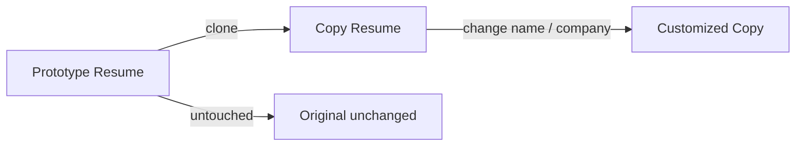
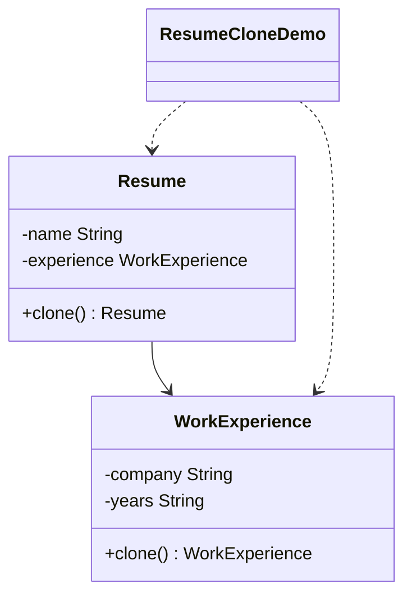

# Resume Clone — Prototype

> Clones a resume template (including its nested work experience) so copies
> can be customized independently, demonstrating a deep copy.

## Big Picture

## Scenario

A recruitment system starts from a base resume template and produces many
personalized copies. Because a resume contains a nested `WorkExperience`
object, a shallow copy would share that reference and edits would leak back
into the prototype. The `clone()` method therefore also clones the nested
experience — a deep copy.

## Design Pattern

**Prototype** — creates new objects by cloning an existing instance rather
than calling a constructor.

Why it fits:

- `Resume` implements `Cloneable` and overrides `clone()`.
- The nested `WorkExperience` is cloned too, illustrating the **deep copy**
  concern that the simple "Shape Clone" example does not cover.
- New copies are produced from the prototype without re-running construction
  logic.

## Structure

| Role | Participants |
|------|--------------|
| Prototype | `Resume` |
| Nested object | `WorkExperience` |
| Client / demo | `ResumeCloneDemo` |

## Design Rationale

- The resume scenario naturally contains a nested object, which lets the
  example demonstrate **deep vs. shallow copy**.
- It complements "Shape Clone" (a single-field object) by adding the
  reference-member dimension.
- One file per type, following the Java convention, keeps each role readable.