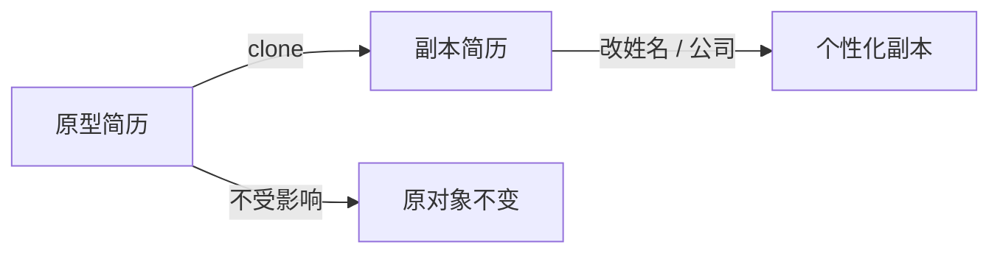
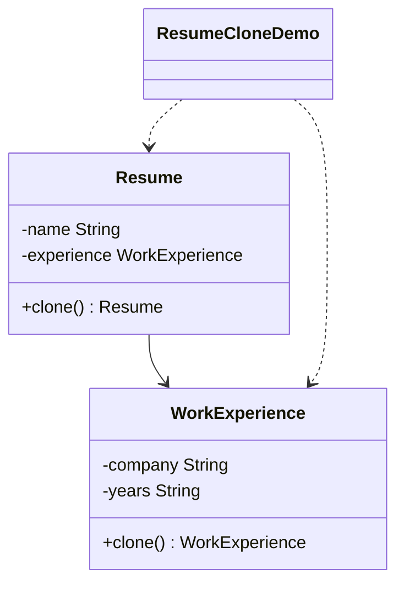

# 简历克隆 — 原型

> 克隆一份简历模板（连同嵌套的工作经历一起），副本可独立修改，
> 直观展示深拷贝。

## 整体概览

## 场景描述

招聘系统从一份基础简历模板出发，批量产出个性化副本。由于简历内嵌了
`WorkExperience` 对象，浅拷贝会共享该引用，对副本的修改会"泄漏"回原型。因此
`clone()` 同时克隆嵌套的工作经历——即深拷贝。

## 设计模式

**原型** —— 通过克隆已有实例来创建新对象，而非调用构造器。

为什么匹配：

- `Resume` 实现 `Cloneable` 并重写 `clone()`。
- 嵌套的 `WorkExperience` 也一并克隆，覆盖了简单"图形克隆"示例未涉及的
  **深拷贝** 问题。
- 副本从原型生成，无需重新执行构造逻辑。

## 结构

| 角色 | 参与者 |
|------|--------|
| 原型 | `Resume` |
| 嵌套对象 | `WorkExperience` |
| 客户端 / 演示 | `ResumeCloneDemo` |

## 设计理念

- 简历天然包含嵌套对象，能顺理成章地演示**深拷贝 vs 浅拷贝**。
- 与"图形克隆"（单字段对象）互补，新增引用成员这一维度。
- 遵循 Java 惯例一个类型一个文件，让每个角色都清晰可读。