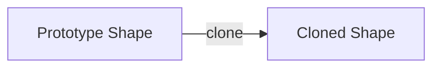
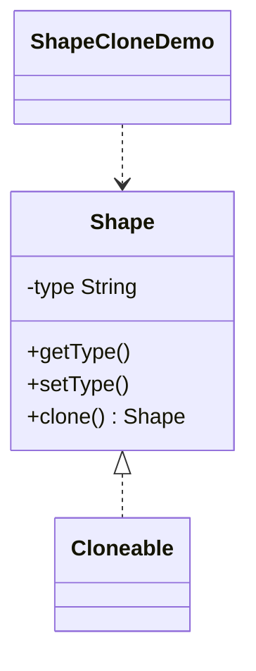

# Shape Clone — Prototype

> Clones an existing shape instead of creating a new one from scratch, so the
> prototype serves as a template for new objects.

## Big Picture

## Scenario

Creating a new object may be costly or complex; when many similar objects are
needed, copying an existing prototype is simpler. Here a shape is cloned and then
customized with a new type.

## Design Pattern

**Prototype** — specifies the kinds of objects to create using a prototypical
instance, and creates new objects by copying this prototype.

Why it fits:

- `Shape` is the **prototype** implementing `Cloneable`.
- `clone()` produces a copy of the existing object instead of calling `new`.
- The cloned object can be modified independently of the original.

## Structure

| Role | Participants |
|------|--------------|
| Prototype | `Shape` |
| Client / demo | `ShapeCloneDemo` |

## Design Rationale

- `clone()` reuses the existing object's state, avoiding costly construction.
- Implementing `Cloneable` and overriding `clone()` is the classic Java way to
  support the prototype pattern.
- The cloned object is decoupled from the original: changing its type does not
  affect the prototype.