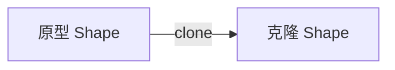
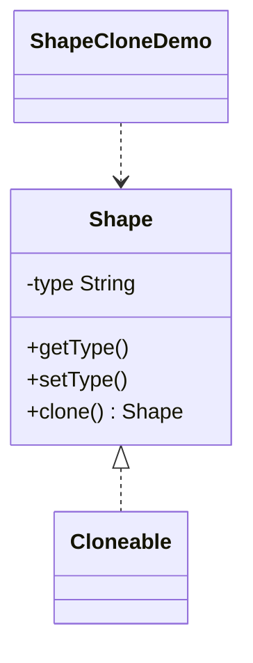

# 图形克隆 — 原型

> 通过克隆已有图形而非从零创建，让原型充当新对象的模板。

## 整体概览

## 场景描述

创建新对象可能成本高昂或过程复杂；当需要大量相似对象时，拷贝已有原型更简单。
这里克隆一个图形，再为其设置新的类型。

## 设计模式

**原型** —— 用原型实例指定要创建的对象种类，并通过拷贝该原型来创建新对象。

为什么匹配：

- `Shape` 是实现了 `Cloneable` 的**原型**。
- `clone()` 生成已有对象的拷贝，而非调用 `new`。
- 克隆对象可独立于原对象进行修改。

## 结构

| 角色 | 参与者 |
|------|--------|
| 原型 | `Shape` |
| 客户端 / 演示 | `ShapeCloneDemo` |

## 设计理念

- `clone()` 复用已有对象的状态，避免高昂的构造过程。
- 实现 `Cloneable` 并重写 `clone()` 是 Java 支持原型模式的经典做法。
- 克隆对象与原对象解耦：修改克隆的类型不会影响原型。