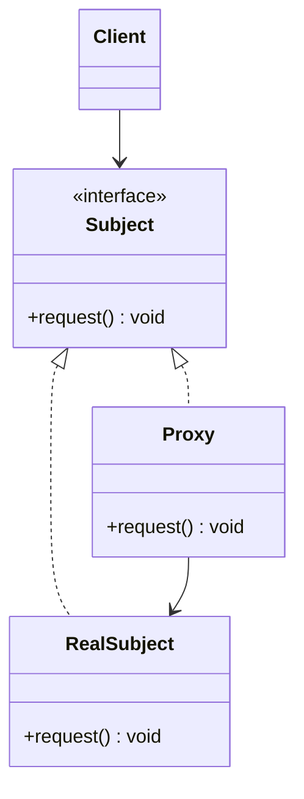

# Proxy Pattern

> Provides a surrogate or placeholder for another object to control access to it.

## Intent

Proxy is a **structural** design pattern. It uses a proxy object as a stand-in for the real object to control access, intercepting or enhancing requests before and after they reach the original object.

## Problem

Sometimes you want to control access to an object through a middleman — because creating or accessing the original involves complex logic, or because you want to perform extra operations before or after access.

## Solution

Proxy provides an object implementing the same interface as the original, so clients can switch seamlessly. The proxy intercepts, modifies or enhances client requests and then forwards them to the original object.

| Role | Description |
|------|-------------|
| Subject | Defines the common interface of the real object and the proxy |
| Real subject | The object that does the actual work |
| Proxy | Holds a reference to the real subject and controls access to it |

## Structure

- **Subject**: the common interface of the real object and the proxy.
- **RealSubject**: the actual business object.
- **Proxy**: controls access to the real subject, enabling lazy creation, permission checks, logging, etc.
- **Client**: depends only on the subject interface.

## Effects

**Pros**

- **Remote proxy**: hides the remote object's location, allowing transparent access.
- **Virtual proxy**: defers creation and initialization of expensive objects.
- **Protection proxy**: controls access permissions.
- **Cache proxy**: caches results to reduce repeated computation.
- **Logging proxy**: records access logs for debugging and auditing.

**Cons**

- **Extra indirection**: introduces additional overhead and complexity.

**When to use**

- When you need to add access control, lazy loading, caching or logging without changing the original object.

## Cases in this project

- [Access Control](accessproxy/README.md) — controls access to sensitive resources via a proxy.
- [Lazy Image](imageproxy/README.md) — defers image loading via a virtual proxy.