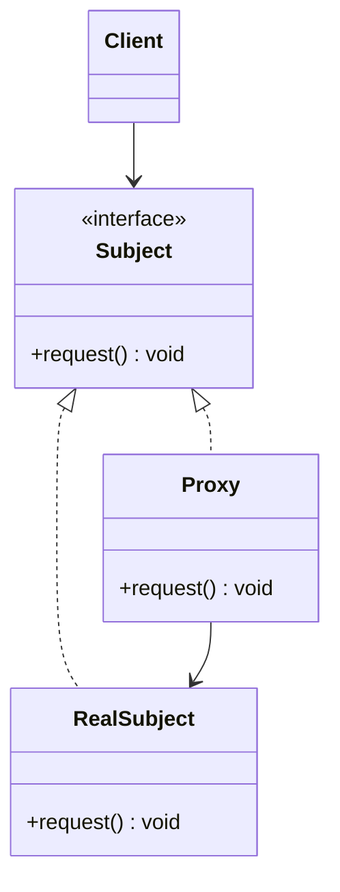

# 代理模式（Proxy）

> 为其他对象提供一种代理以控制对这个对象的访问。

## 意图

代理模式（Proxy）是一种**结构型**设计模式。它通过代理对象充当原始对象的替身，控制对原始对象的访问，可在访问前后拦截、增强请求。

## 问题

有时希望通过中间代理控制对某对象的访问——可能因为原对象的创建或访问涉及复杂逻辑，或者希望在访问前后执行额外操作。

## 解决方案

代理模式提供与原始对象实现相同接口的代理对象，使客户端可无缝切换使用。代理拦截、修改或增强客户端请求，再转交给原始对象。

| 角色 | 说明 |
|------|------|
| 主题 | 定义真实对象与代理的共同接口 |
| 真实主题 | 实际完成工作的对象 |
| 代理 | 持有真实主题引用，控制对它的访问 |

## 结构

- **主题（Subject）**：真实对象与代理的共同接口。
- **真实主题（RealSubject）**：实际业务对象。
- **代理（Proxy）**：控制对真实主题的访问，可延迟创建、校验权限、记录日志等。
- **客户端（Client）**：只依赖主题接口。

## 效果

**优点**

- **远程代理**：隐藏远程对象的位置，客户端透明访问。
- **虚拟代理**：延迟高开销对象的创建与初始化。
- **保护代理**：控制访问权限。
- **缓存代理**：缓存结果，减少重复计算。
- **日志代理**：记录访问日志，便于调试与审计。

**缺点**

- **增加间接层**：引入代理可能带来额外开销与复杂度。

**适用场景**

- 需要在不改变原始对象的情况下，添加访问控制、延迟加载、缓存、日志等能力的场景。

## 项目中的案例

- [权限控制](accessproxy/README_zh.md) —— 用代理控制对敏感资源的访问权限。
- [图片延迟加载](imageproxy/README_zh.md) —— 用虚拟代理延迟加载图片资源。