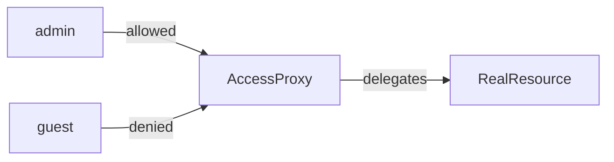
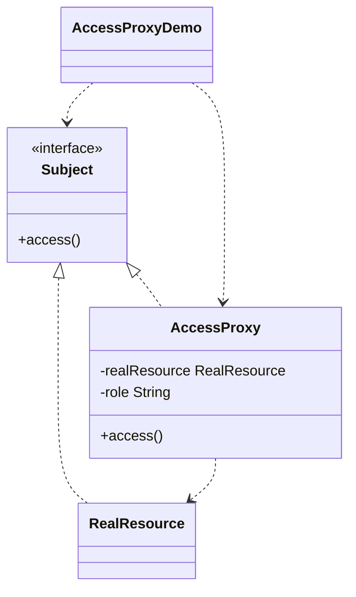

# Access Control — Proxy

> Guards a sensitive resource behind a proxy that checks the caller's role
> before granting access.

## Big Picture

## Scenario

A sensitive resource must only be accessible to certain roles. Clients talk
to the resource through a proxy that verifies the role: `admin` is allowed
through, everyone else is rejected before the real object is even created.

## Design Pattern

**Proxy** — provides a surrogate that controls access to another object.

Why it fits:

- `Subject` is the common interface for both the real object and the proxy.
- `AccessProxy` checks the role and only then delegates to `RealResource`.
- The real object is created lazily and only for authorized callers.

## Structure

| Role | Participants |
|------|--------------|
| Subject | `Subject` |
| Real subject | `RealResource` |
| Proxy | `AccessProxy` |
| Client / demo | `AccessProxyDemo` |

## Design Rationale

- The access-control scenario is a classic protection proxy, distinct from
  the existing "Lazy Image" (virtual proxy) example.
- Permission checking before delegation shows a different proxy purpose than
  lazy loading.
- One file per type, following the Java convention, keeps each role readable.