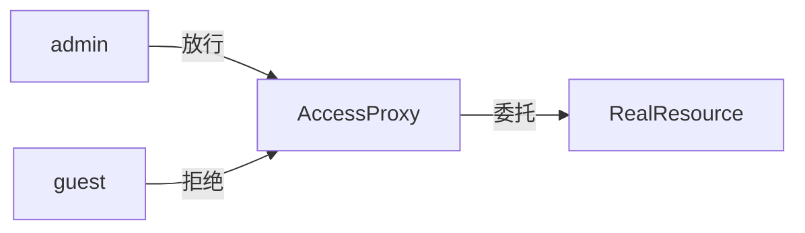
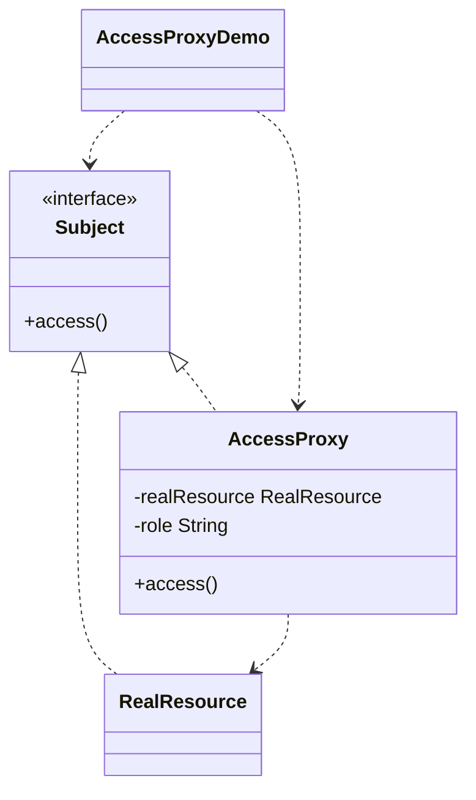

# 权限控制 — 代理

> 用代理守卫敏感资源，先校验调用方角色再决定是否放行。

## 整体概览

## 场景描述

敏感资源只能被特定角色访问。客户端通过代理与资源交互，代理先校验角色：
`admin` 放行，其余角色在真实对象创建之前就被拒绝。

## 设计模式

**代理** —— 提供一个替身来控制对另一对象的访问。

为什么匹配：

- `Subject` 是真实对象与代理的共同接口。
- `AccessProxy` 先校验角色，之后才委托给 `RealResource`。
- 真实对象延迟创建，且只为被授权的调用方创建。

## 结构

| 角色 | 参与者 |
|------|--------|
| 主题 | `Subject` |
| 真实主题 | `RealResource` |
| 代理 | `AccessProxy` |
| 客户端 / 演示 | `AccessProxyDemo` |

## 设计理念

- 权限控制场景是经典的保护代理，与已有的"图片延迟加载"（虚拟代理）示例明显区分。
- 委托前的权限校验体现了与延迟加载不同的代理用途。
- 遵循 Java 惯例一个类型一个文件，让每个角色都清晰可读。