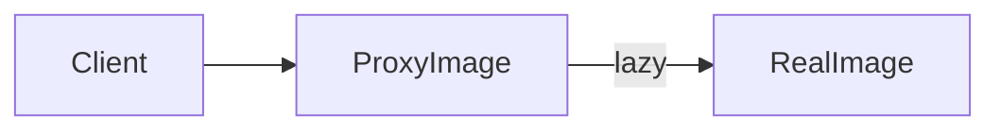
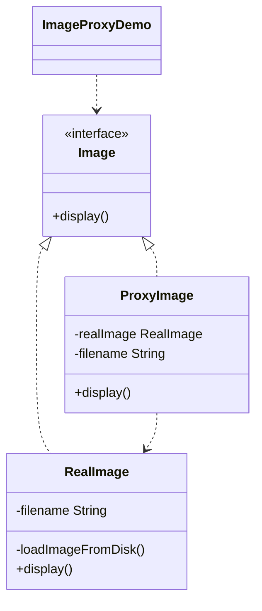

# Lazy Image — Proxy

> A proxy defers loading a heavy image until it is actually displayed, saving
> resources until the real object is needed.

## Big Picture

## Scenario

Loading an image from disk is expensive, so we only want to do it when the image
is first shown. A proxy stands in for the real image, creating it lazily on the
first `display()` call and reusing it afterwards.

## Design Pattern

**Proxy** — provides a surrogate or placeholder for another object to control
access to it.

Why it fits:

- `Image` is the **subject** interface; `RealImage` is the **real subject** that
  loads from disk.
- `ProxyImage` is the **proxy** that delays creation of `RealImage`.
- The client only sees `Image`, unaware of the lazy-loading behind the proxy.

## Structure

| Role | Participants |
|------|--------------|
| Subject | `Image` |
| Real subject | `RealImage` |
| Proxy | `ProxyImage` |
| Client / demo | `ImageProxyDemo` |

## Design Rationale

- The expensive `RealImage` is created only when first needed, saving resources.
- The proxy and real subject share the same `Image` interface, so the client is
  unchanged.
- Subsequent `display()` calls reuse the already-loaded image, avoiding repeated
  loading.