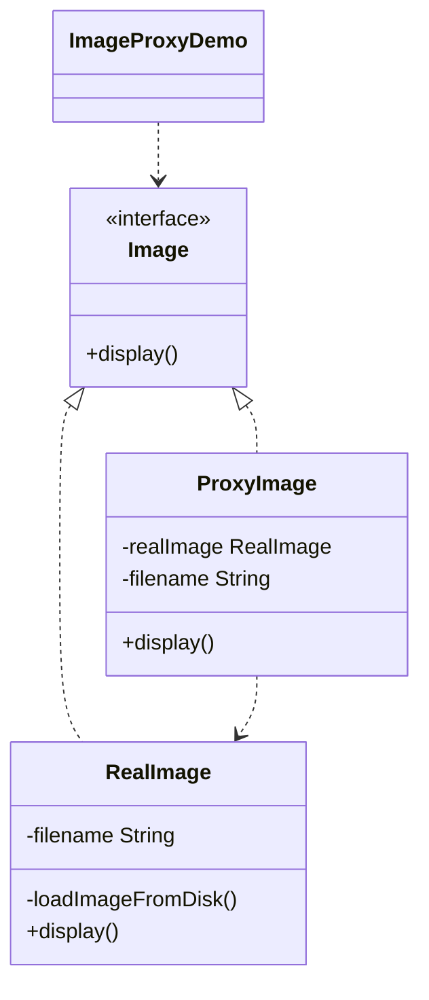

# 图片延迟加载 — 代理

> 代理将重图片的加载推迟到真正显示时才进行，在需要真实对象之前节省资源。

## 整体概览

## 场景描述

从磁盘加载图片代价高昂，因此只想在图片首次显示时才加载。代理代表真实图片，
在首次 `display()` 调用时懒创建，之后复用。

## 设计模式

**代理** —— 为另一个对象提供替身或占位符，以控制对其的访问。

为什么匹配：

- `Image` 是**主题**接口；`RealImage` 是从磁盘加载的**真实主题**。
- `ProxyImage` 是延迟创建 `RealImage` 的**代理**。
- 客户端只看到 `Image`，感知不到代理背后的懒加载。

## 结构

| 角色 | 参与者 |
|------|--------|
| 主题 | `Image` |
| 真实主题 | `RealImage` |
| 代理 | `ProxyImage` |
| 客户端 / 演示 | `ImageProxyDemo` |

## 设计理念

- 昂贵的 `RealImage` 仅在首次需要时创建，节省资源。
- 代理与真实主题共享同一 `Image` 接口，客户端无需改变。
- 后续 `display()` 复用已加载的图片，避免重复加载。