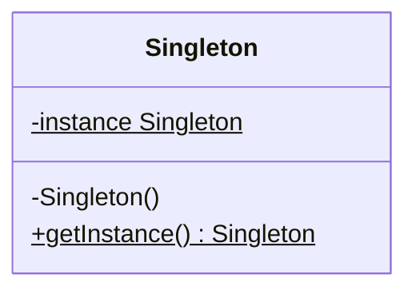

# Singleton Pattern

> Ensures a class has only one instance and provides a global point of access to it.

## Intent

Singleton is a **creational** design pattern. It guarantees global uniqueness by restricting instantiation, and provides a global access point through a static method.

## Problem

Some scenarios require a class to have exactly one instance and a global access point to reach it. For example, an application's configuration manager must keep consistent data to avoid conflicts between different parts of the program.

## Solution

Singleton declares its constructor private to prevent external instantiation, and provides a static method that returns the same instance at runtime.

| Role | Description |
|------|-------------|
| Singleton | Keeps the constructor private, holds the unique instance, and exposes it via a static method |

## Structure

- **Singleton**: holds a private static instance of itself, has a private constructor, and exposes the unique instance through the static `getInstance()` method.

## Effects

**Pros**

- **Resource saving**: only one instance exists, saving memory and resources.
- **Global access point**: every part of the code can easily obtain the instance.

**Cons**

- **Hard-to-control global state**: overuse introduces uncontrolled global state and tight coupling between modules.
- **Thread safety**: extra handling is required in multithreaded environments.

**When to use**

- When a globally unique instance is needed, such as configuration management, connection pools, or loggers.

## Cases in this project

- [Global Config](configmanager/README.md) — manages application configuration through a singleton.
- [Static Inner Class](innerclasssingleton/README.md) — implements a thread-safe singleton using a static inner class.