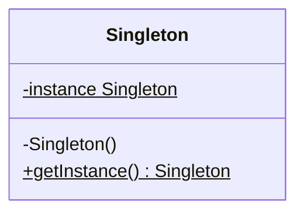

# 单例模式（Singleton）

> 保证一个类仅有一个实例，并提供一个访问它的全局访问点。

## 意图

单例模式（Singleton）是一种**创建型**设计模式。它通过限制类的实例化来保证全局唯一性，并通过一个静态方法提供全局访问点。

## 问题

有些场景需要确保一个类只有一个实例，并需要一个全局访问点来访问它。例如，应用程序的配置管理器需要保持一致的数据，避免不同部分之间的配置冲突。

## 解决方案

单例模式将构造函数声明为私有，阻止外部直接实例化，并提供一个静态方法在运行时只返回同一个实例。

| 角色 | 说明 |
|------|------|
| 单例 | 私有化构造方法，维护唯一实例，并通过静态方法提供全局访问 |

## 结构

- **单例（Singleton）**：持有自身的私有静态实例，构造函数私有，静态方法 `getInstance()` 返回该唯一实例。

## 效果

**优点**

- **节省资源**：整个应用只有一个实例，节省内存与资源。
- **全局访问点**：代码各处都能方便地获取该实例。

**缺点**

- **全局状态难控**：过度使用会引入难以控制的全局状态与模块间紧耦合。
- **线程安全**：多线程环境下需要额外处理以保证线程安全。

**适用场景**

- 需要全局唯一实例的场景，如配置管理、连接池、日志记录器等。

## 项目中的案例

- [全局配置](configmanager/README_zh.md) —— 用单例统一管理应用配置。
- [静态内部类](innerclasssingleton/README_zh.md) —— 用静态内部类实现线程安全的单例。