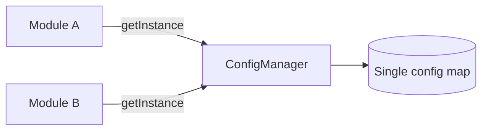
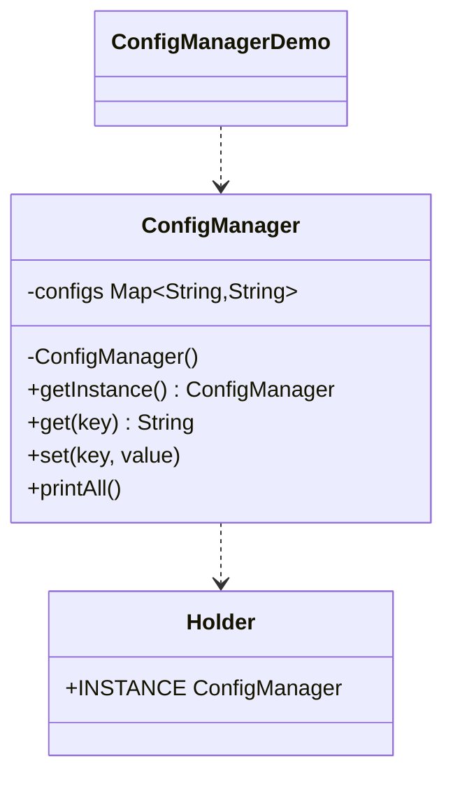

# Global Config — Singleton

> A single, shared configuration store that the whole application reads and
> writes through one entry point.

## Big Picture

## Scenario

An application needs to read global settings (app name, version, locale,
theme …) from many places. If each module loaded its own copy, values would
drift apart. Instead we provide one `ConfigManager` that loads defaults at
startup and is shared by everyone through `getInstance()`.

## Design Pattern

**Singleton** — ensures a class has only one instance and provides a global
access point to it.

Why it fits:

- Configuration must be **globally consistent**, so a single shared instance
  is the natural model.
- The private constructor prevents callers from creating divergent copies.
- `getInstance()` is the single access point used by all modules.

## Structure

| Role | Participants |
|------|--------------|
| Singleton | `ConfigManager` |
| Lazy holder | `Holder` |
| Client / demo | `ConfigManagerDemo` |

## Design Rationale

- The scenario focuses on the **domain** (global config) rather than the
  implementation technique, complementing the existing "Static Inner Class"
  example.
- The static inner class `Holder` keeps initialization lazy and thread-safe,
  mirroring the project's recommended singleton style.