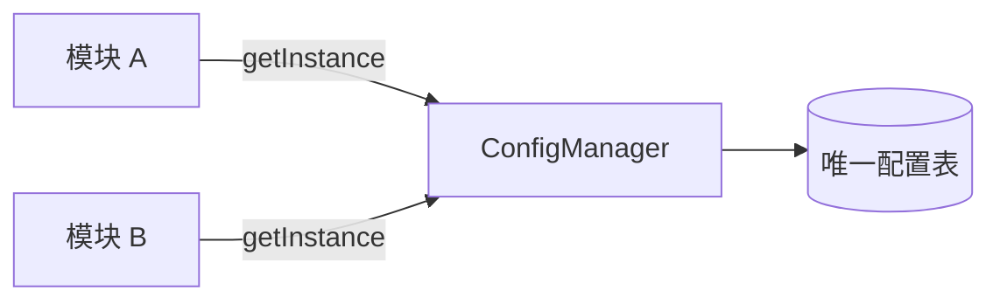
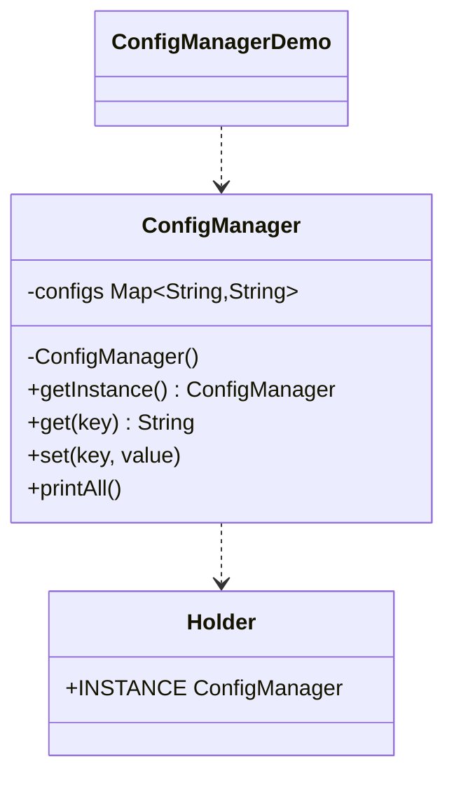

# 全局配置 — 单例模式

> 全应用共享一个配置存储，所有模块通过同一个入口读取与修改。

## 整体概览

## 场景描述

一个应用需要在很多地方读取全局设置（应用名、版本、语言、主题……）。如果每个
模块各自加载一份，配置就会互相漂移。于是我们提供一个 `ConfigManager`，启动时
加载默认值，所有人都通过 `getInstance()` 共享同一个实例。

## 设计模式

**单例模式** —— 确保一个类只有一个实例，并提供全局访问点。

为什么匹配：

- 配置必须**全局一致**，单一共享实例是最自然的模型。
- 私有构造禁止外部再创建副本。
- `getInstance()` 是各模块唯一访问入口。

## 结构

| 角色 | 参与者 |
|------|--------|
| 单例类 | `ConfigManager` |
| 懒加载持有者 | `Holder` |
| 客户端 / 演示 | `ConfigManagerDemo` |

## 设计理念

- 本场景聚焦**业务语义**（全局配置）而非实现技巧，与已有的"静态内部类"示例互补。
- 静态内部类 `Holder` 保证懒加载与线程安全，延续项目推荐的单例写法。