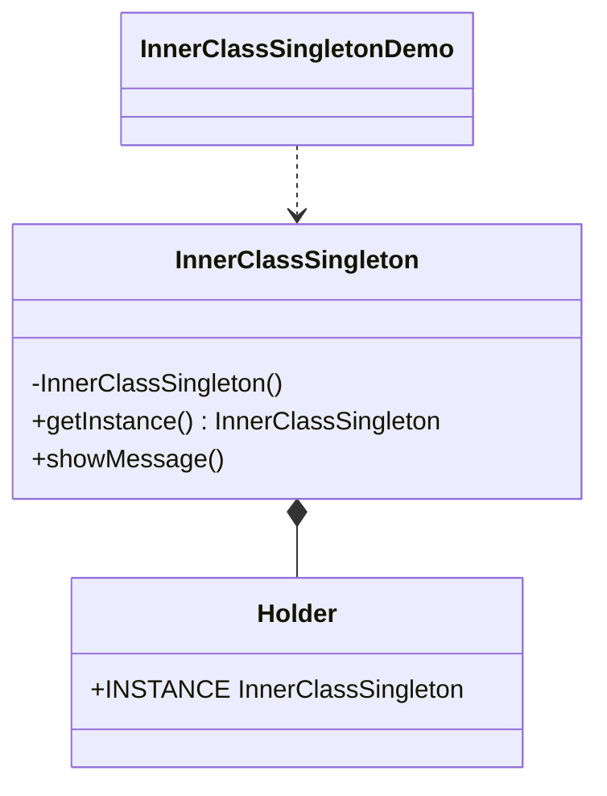

# Static Inner Class — Singleton

> Implements the singleton pattern with a private static inner class that holds
> the sole instance, combining lazy initialization with thread safety.

## Big Picture

## Scenario

A global component (e.g. a connection manager or configuration holder) must have
exactly one instance for the whole application. The static inner class approach
creates the instance only on first access and is thread-safe by JVM semantics.

## Design Pattern

**Singleton** — ensures a class has only one instance and provides a global point
of access to it.

Why it fits:

- The constructor is private, so no external code can create another instance.
- `getInstance()` returns the single instance held by the static inner class.
- The `Holder` class is loaded (and its `INSTANCE` initialized) only when
  `getInstance()` is first called, achieving lazy initialization.

## Structure

| Role | Participants |
|------|--------------|
| Singleton | `InnerClassSingleton` |
| Instance holder | `InnerClassSingleton.Holder` |
| Client / demo | `InnerClassSingletonDemo` |

## Design Rationale

- The static inner class is not loaded until `getInstance()` is called, so the
  instance is created lazily without extra synchronization code.
- The JVM guarantees a class is initialized exactly once, which makes the holder
  approach naturally thread-safe.
- The holder is intentionally kept as a private nested class, because that
  nesting is the essence of this pattern.