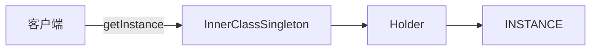
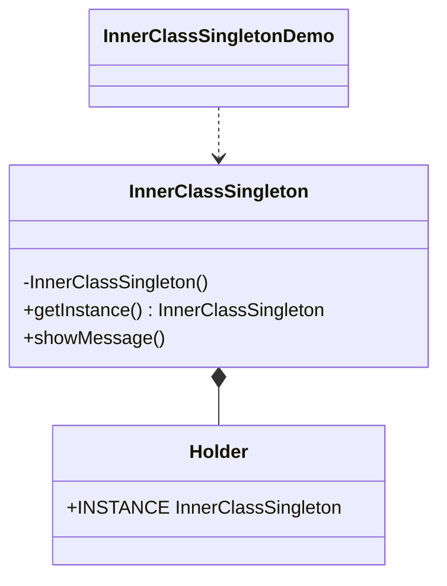

# 静态内部类 — 单例

> 通过私有静态内部类持有唯一实例，实现单例模式，兼顾懒加载与线程安全。

## 整体概览

## 场景描述

某个全局组件（如连接管理器或配置持有者）在整个应用中只能有一个实例。静态
内部类方式在首次访问时才创建实例，并借助 JVM 语义保证线程安全。

## 设计模式

**单例** —— 保证一个类只有一个实例，并提供全局访问点。

为什么匹配：

- 构造方法私有，外部无法创建其他实例。
- `getInstance()` 返回静态内部类持有的唯一实例。
- `Holder` 类仅在首次调用 `getInstance()` 时才被加载并初始化 `INSTANCE`，
  从而实现懒加载。

## 结构

| 角色 | 参与者 |
|------|--------|
| 单例 | `InnerClassSingleton` |
| 实例持有者 | `InnerClassSingleton.Holder` |
| 客户端 / 演示 | `InnerClassSingletonDemo` |

## 设计理念

- 静态内部类直到 `getInstance()` 被调用时才加载，因此无需额外同步代码即可
  实现懒加载。
- JVM 保证类只初始化一次，使持有者方式天然线程安全。
- 持有者刻意保留为私有内部类，因为这种嵌套正是该模式的精髓。