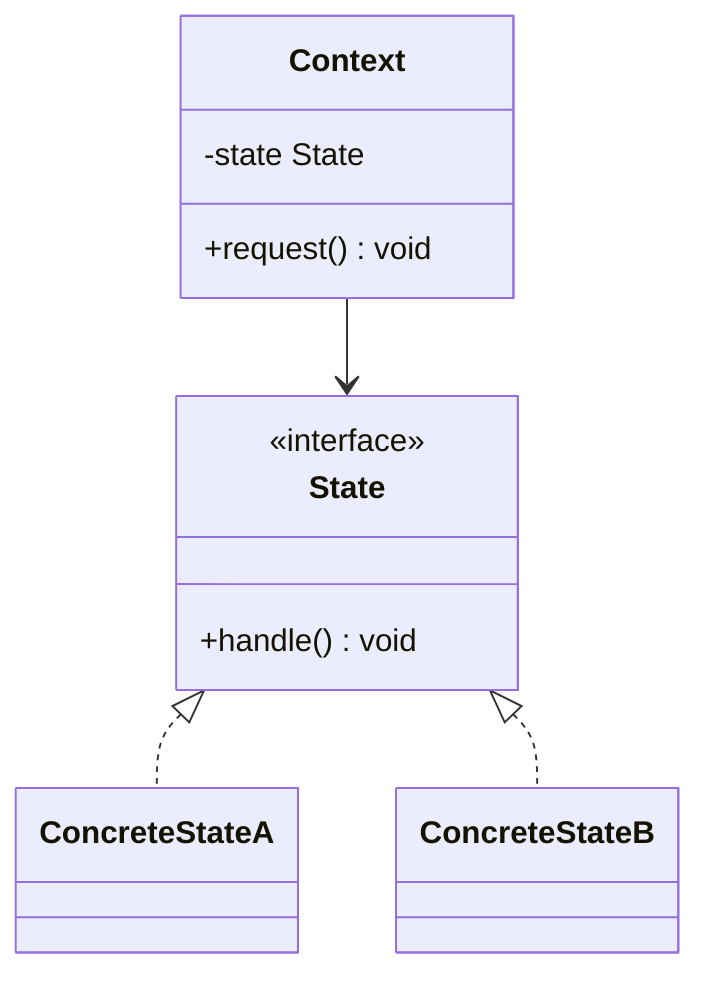

# State Pattern

> Allows an object to alter its behavior when its internal state changes.

## Intent

State is a **behavioral** design pattern. It abstracts an object's state into independent state classes, with the context holding the current state and delegating operations to it, so the object behaves differently in different states.

## Problem

When an object's behavior depends on its internal state and it must act differently per state, implementing all state transitions inside the object makes the code complex and hard to maintain.

## Solution

State encapsulates each state in its own class; the context keeps a reference to the current state and delegates operations to it, separating behavior across states.

| Role | Description |
|------|-------------|
| Context | Holds the current state reference and delegates operations |
| State | Declares the state interface and its operations |
| Concrete state | Implements the behavior of a specific state |

## Structure

- **Context**: holds the current state and delegates requests to it.
- **State**: declares the operation interface for each state.
- **ConcreteState**: implements the behavior of a specific state.

## Effects

**Pros**

- **Clear transitions**: each state's behavior lives in its own class.
- **Maintainability**: state-related code is modular.
- **Extensibility**: new states are added via new state classes.
- **Avoids conditionals**: polymorphism replaces large `if-else` blocks.

**Cons**

- **More classes**: every state needs its own class.

**When to use**

- When an object's behavior varies with its state and complex state logic must be handled.

## Cases in this project

- [Gumball Machine](gumball/README.md) — manages the different states of a gumball machine.
- [Elevator State](elevator/README.md) — manages opening, closing and moving states of an elevator.