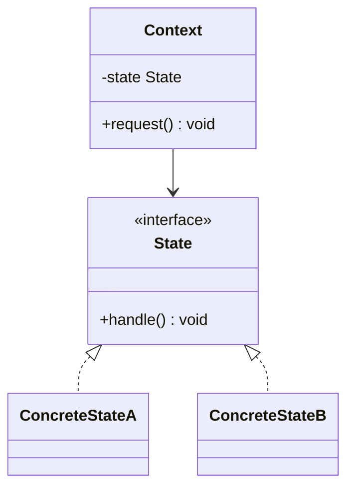

# 状态模式（State）

> 允许一个对象在其内部状态改变时改变它的行为。

## 意图

状态模式（State）是一种**行为型**设计模式。它把对象的状态抽象成独立的状态类，由上下文对象持有当前状态并委托执行操作，使对象在不同状态下表现出不同行为。

## 问题

当一个对象的行为随内部状态改变，且需要根据状态执行不同操作时，若把状态切换逻辑全部写在对象内部，代码会变得复杂且难以维护。

## 解决方案

状态模式将每个状态封装成独立的状态类，上下文对象维护当前状态引用，通过委托当前状态执行操作，从而把不同状态的行为分隔开。

| 角色 | 说明 |
|------|------|
| 上下文 | 持有当前状态引用，委托状态执行操作 |
| 状态 | 定义状态接口，声明各状态下的操作 |
| 具体状态 | 实现状态接口，完成该状态下的行为 |

## 结构

- **上下文（Context）**：持有当前状态，把请求委托给状态对象。
- **状态（State）**：声明各状态下的操作接口。
- **具体状态（ConcreteState）**：实现该状态下的具体行为。

## 效果

**优点**

- **清晰的状态切换**：每个状态的行为集中在各自类中，逻辑清晰。
- **可维护性**：状态相关代码模块化。
- **扩展性**：新增状态只需新增状态类。
- **避免条件语句**：用多态替代大量 `if-else`。

**缺点**

- **类数量增加**：每个状态都需要一个类。

**适用场景**

- 对象行为随状态变化、需要处理复杂状态逻辑的场景。

## 项目中的案例

- [糖果机](gumball/README_zh.md) —— 用状态模式管理糖果机的不同状态。
- [电梯状态](elevator/README_zh.md) —— 用状态模式管理电梯的开门、关门、移动等状态。