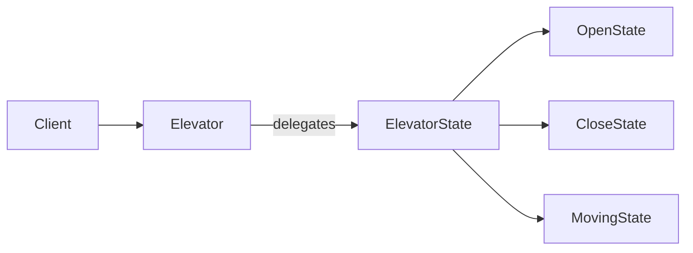
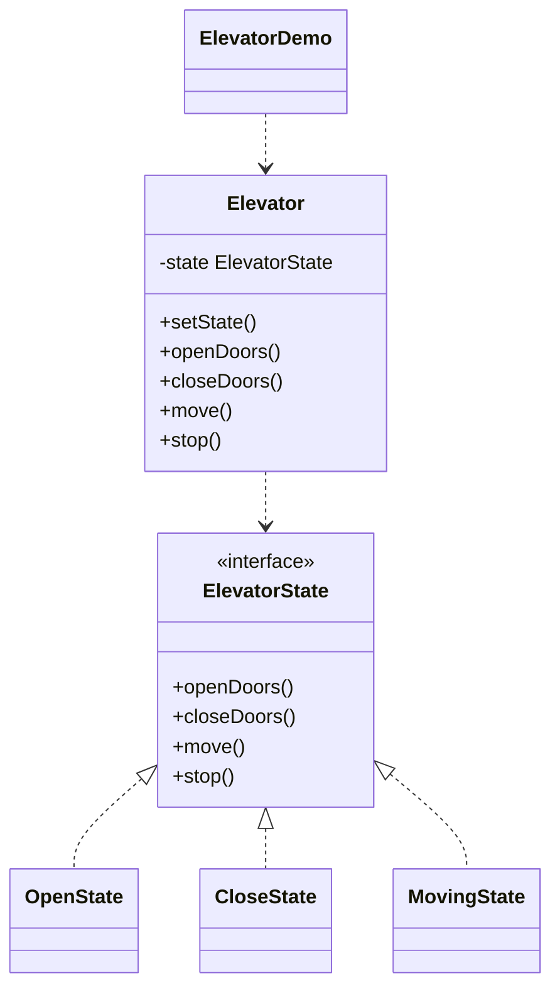

# Elevator State — State

> Models an elevator whose behavior (open/close/move/stop) changes with its
> current state, encapsulating each state as a separate object.

## Big Picture

## Scenario

An elevator cannot move while its doors are open, and cannot open its doors while
moving. Instead of a big if-else, each state object defines the allowed behavior
and the elevator simply delegates to the current state.

## Design Pattern

**State** — allows an object to alter its behavior when its internal state
changes, as if the object changed its class.

Why it fits:

- `Elevator` is the **context** that holds the current `ElevatorState`.
- `OpenState`/`CloseState`/`MovingState` are **concrete states** implementing
  the same interface.
- `Elevator` switches its state after each action, so the next action behaves
  according to the new state.

## Structure

| Role | Participants |
|------|--------------|
| Context | `Elevator` |
| State | `ElevatorState` |
| Concrete states | `OpenState`, `CloseState`, `MovingState` |
| Client / demo | `ElevatorDemo` |

## Design Rationale

- Each state encapsulates its own rules, so adding a new state does not touch the
  existing states.
- The context stays clean: it only delegates and switches states, keeping all
  branching inside the state classes.
- Using `instanceof` in the context keeps the transition logic simple and clear.