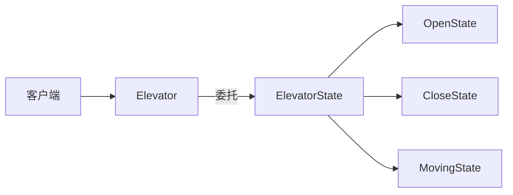
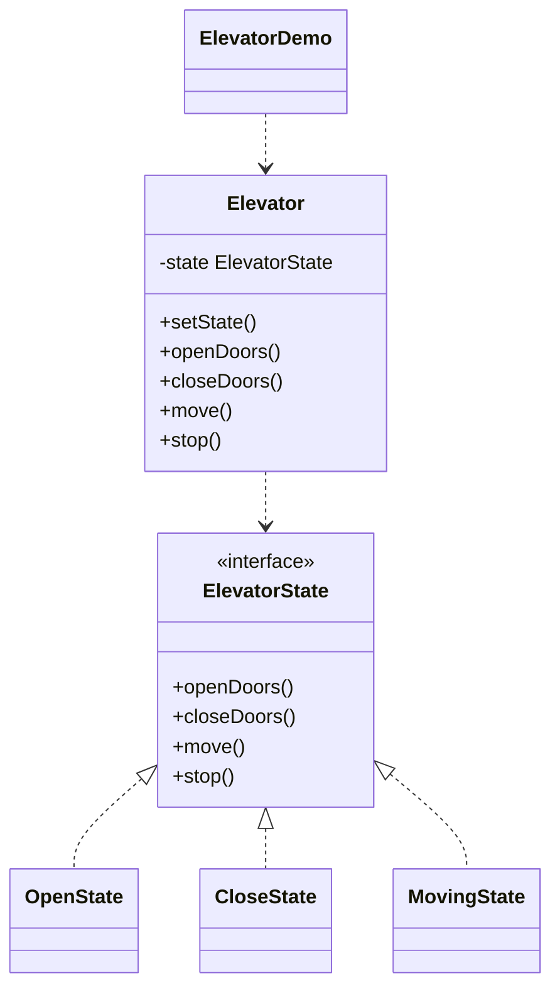

# 电梯状态 — 状态

> 用状态对象建模电梯，其行为（开门/关门/移动/停止）随当前状态变化，每个状态
> 封装为一个独立对象。

## 整体概览

## 场景描述

电梯在开门时不能移动，移动时不能开门。与其用一大段 if-else，不如让每个状态
对象定义允许的行为，电梯只需把动作委托给当前状态。

## 设计模式

**状态** —— 允许对象在其内部状态改变时改变行为，看起来就像对象换了类。

为什么匹配：

- `Elevator` 是持有当前 `ElevatorState` 的**上下文**。
- `OpenState`/`CloseState`/`MovingState` 是实现同一接口的**具体状态**。
- 每个状态对象持有 `Elevator` 引用，在动作后自行切换到下一状态。

## 结构

| 角色 | 参与者 |
|------|--------|
| 上下文 | `Elevator` |
| 状态 | `ElevatorState` |
| 具体状态 | `OpenState`、`CloseState`、`MovingState` |
| 客户端 / 演示 | `ElevatorDemo` |

## 设计理念

- 每个状态封装自己的规则，新增状态无需改动已有状态。
- 上下文保持简洁：只负责委托，状态迁移与分支全部留在状态类内部。