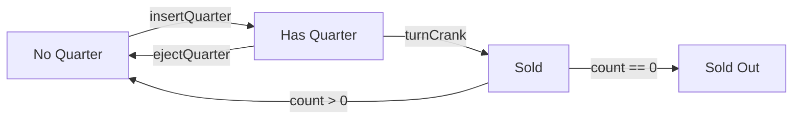
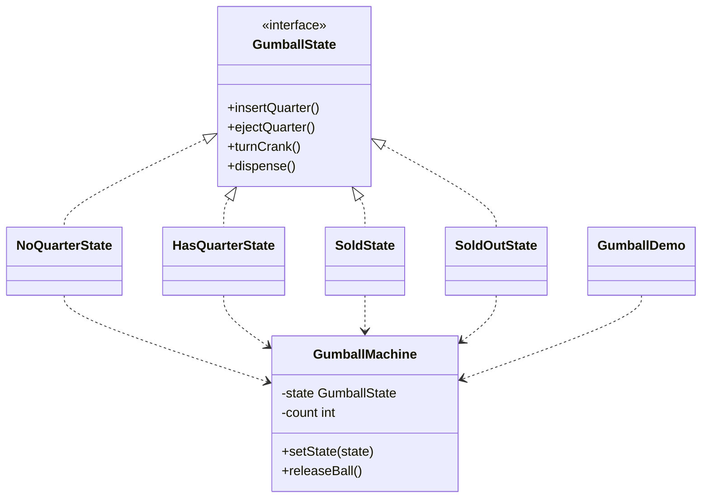

# Gumball Machine — State

> A gumball machine changes behavior as it moves through no-quarter,
> has-quarter, sold, and sold-out states.

## Big Picture

## Scenario

A gumball machine accepts a quarter, dispenses a gumball on crank, and
eventually runs out. The allowed actions depend on the current state — for
example, cranking does nothing without a quarter. Each state encapsulates
those rules and triggers the transition to the next state.

## Design Pattern

**State** — lets an object alter its behavior when its internal state
changes.

Why it fits:

- `GumballState` declares the actions available in every state.
- `NoQuarterState`, `HasQuarterState`, `SoldState`, `SoldOutState` implement
  the rules for each state.
- `GumballMachine` (context) delegates actions and holds the current state.

## Structure

| Role | Participants |
|------|--------------|
| State | `GumballState` |
| Concrete states | `NoQuarterState`, `HasQuarterState`, `SoldState`, `SoldOutState` |
| Context | `GumballMachine` |
| Client / demo | `GumballDemo` |

## Design Rationale

- The gumball machine is the canonical state example with four states,
  distinct from the "Elevator" (open/close/move) example.
- Rich transitions (insert/eject/crank/dispense) show behavior varying with
  internal state without a single if/else chain.
- One file per type, following the Java convention, keeps each role readable.