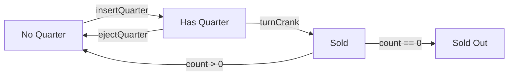
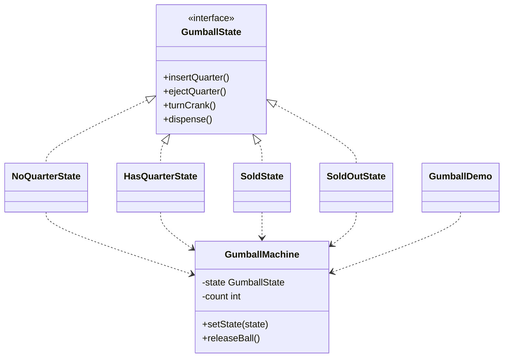

# 糖果机 — 状态

> 糖果机在无硬币、有硬币、售出中、售罄四个状态间切换，行为随之改变。

## 整体概览

## 场景描述

糖果机接收硬币、转动曲柄后出货，最终售罄。可执行的动作取决于当前状态——例如没有
硬币时转动曲柄无效。每个状态封装这些规则，并触发向下一个状态的迁移。

## 设计模式

**状态** —— 让对象在内部状态变化时改变其行为。

为什么匹配：

- `GumballState` 声明每个状态都可执行的动作。
- `NoQuarterState`、`HasQuarterState`、`SoldState`、`SoldOutState` 实现各状态规则。
- `GumballMachine`（上下文）持有当前状态并委托动作。

## 结构

| 角色 | 参与者 |
|------|--------|
| 状态 | `GumballState` |
| 具体状态 | `NoQuarterState`、`HasQuarterState`、`SoldState`、`SoldOutState` |
| 上下文 | `GumballMachine` |
| 客户端 / 演示 | `GumballDemo` |

## 设计理念

- 糖果机是状态模式的经典四状态示例，与"电梯"（开/关/移动）示例明显区分。
- 丰富的状态迁移（投币/退币/转动/出货）展示了行为随内部状态变化，而无须整串
  if/else。
- 遵循 Java 惯例一个类型一个文件，让每个角色都清晰可读。