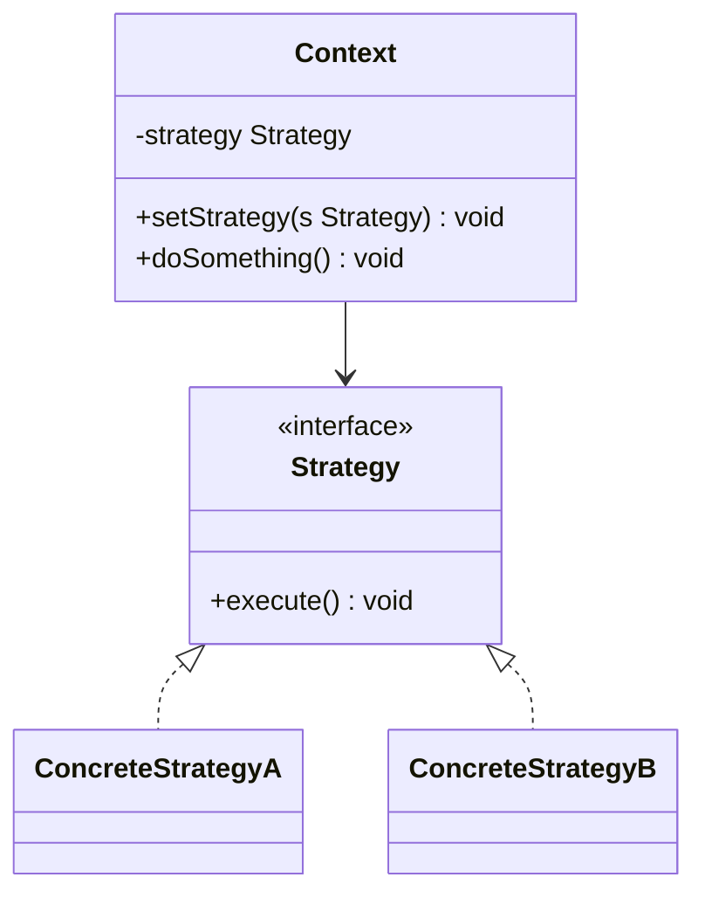

# Strategy Pattern

> Defines a family of algorithms, encapsulates each one, and makes them interchangeable.

## Intent

Strategy is a **behavioral** design pattern. It encapsulates a family of algorithms into independent strategy classes that are interchangeable; clients choose among them at runtime through a context, without modifying the context's code.

## Problem

A system may need different algorithms or behaviors depending on the situation, and the choice changes frequently. Hardcoding the algorithms in the main class bloats the code and makes it hard to maintain and extend.

## Solution

Strategy encapsulates each algorithm in a strategy class; the context holds a strategy reference and delegates to it. Clients can switch strategies at runtime, decoupling algorithms from clients.

| Role | Description |
|------|-------------|
| Strategy | Declares the algorithm interface |
| Concrete strategy | Implements a specific algorithm |
| Context | Holds a strategy reference and invokes its method |

## Structure

- **Strategy**: declares the algorithm interface.
- **ConcreteStrategy**: implements a specific algorithm.
- **Context**: holds a strategy reference and delegates requests to it.

## Effects

**Pros**

- **Algorithm decoupling**: algorithms change independently of clients.
- **Maintainable and extensible**: new strategies are easy to add.
- **Eliminates conditionals**: polymorphism replaces large `if-else` blocks.

**Cons**

- **More classes**: every algorithm needs a strategy class.

**When to use**

- When you need to select different algorithms or behaviors depending on the situation.

## Cases in this project

- [Payment](payment/README.md) — switches between different payment methods.
- [Calculator](calculator/README.md) — switches between add, subtract, multiply and other operations.