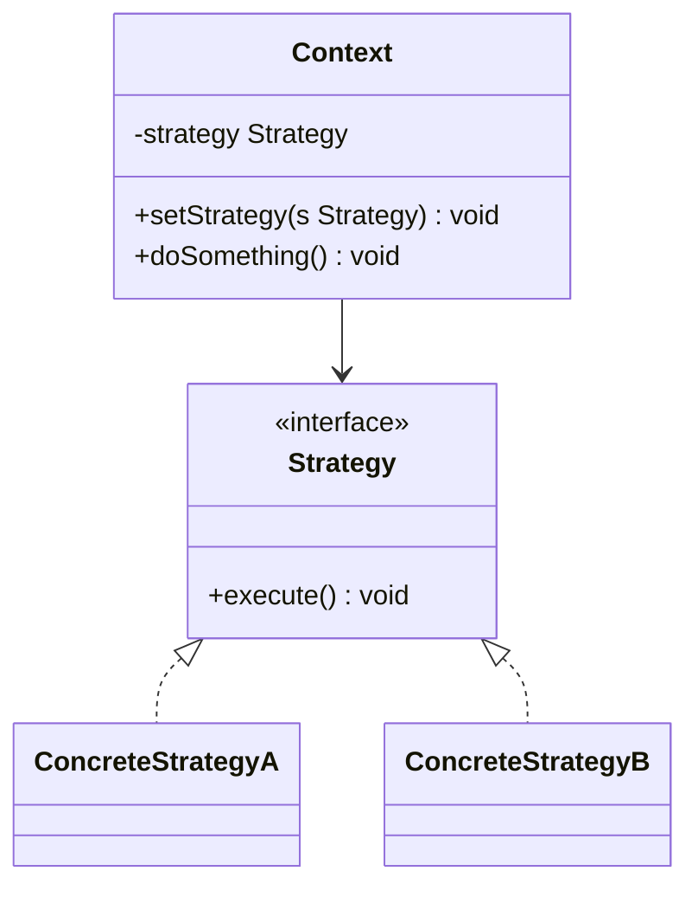

# 策略模式（Strategy）

> 定义一系列的算法，把它们一个个封装起来，并且使它们可相互替换。

## 意图

策略模式（Strategy）是一种**行为型**设计模式。它把一组算法封装成独立的策略类并使其可互相替换，客户端通过上下文在运行时选择不同策略，而无需修改上下文代码。

## 问题

系统可能需要根据不同情境选择不同算法或行为，而这些算法的选择会频繁变化。若把算法硬编码在主类中，会导致代码臃肿、难以维护与扩展。

## 解决方案

策略模式把每个算法封装成策略类，上下文持有策略引用并委托调用。客户端可在运行时切换策略，实现算法与客户端解耦。

| 角色 | 说明 |
|------|------|
| 策略 | 定义算法接口 |
| 具体策略 | 实现具体算法 |
| 上下文 | 持有策略引用，调用策略方法 |

## 结构

- **策略（Strategy）**：声明算法接口。
- **具体策略（ConcreteStrategy）**：实现具体算法。
- **上下文（Context）**：持有策略引用，把请求委托给策略。

## 效果

**优点**

- **算法解耦**：算法独立于客户端变化。
- **可维护与扩展**：新策略易于添加。
- **消除条件分支**：用多态替代大量 `if-else`。

**缺点**

- **类数量增加**：每个算法都需要一个策略类。

**适用场景**

- 需要根据情境灵活选择不同算法或行为的场景。

## 项目中的案例

- [支付方式](payment/README_zh.md) —— 用策略切换不同的支付方式。
- [计算器](calculator/README_zh.md) —— 用策略切换加、减、乘等运算。