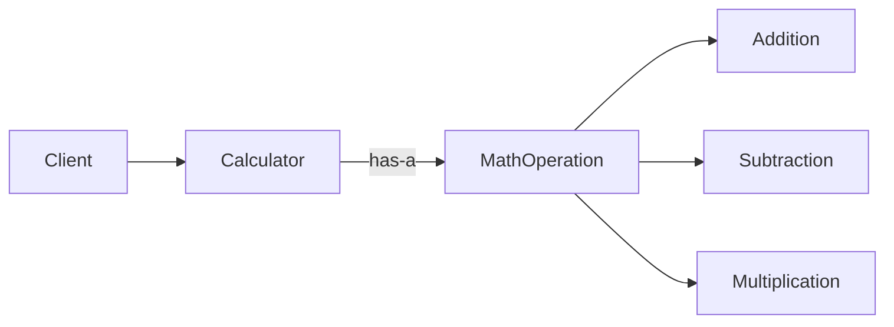
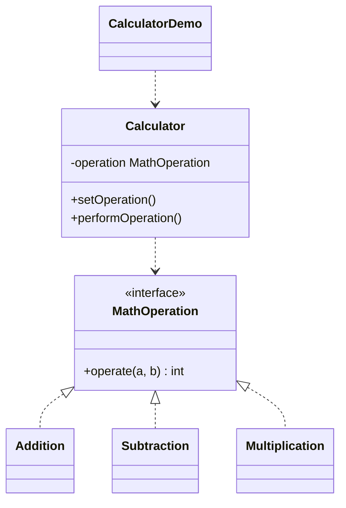

# Calculator — Strategy

> A calculator whose arithmetic operation (add/subtract/multiply) is a pluggable
> strategy that can be swapped at runtime.

## Big Picture

## Scenario

A calculator should support different operations that the user selects at
runtime. Instead of hard-coding the operations, each operation is a separate
strategy object that the calculator can switch between.

## Design Pattern

**Strategy** — defines a family of algorithms, encapsulates each one, and makes
them interchangeable.

Why it fits:

- `MathOperation` is the **strategy** interface; `Addition`/`Subtraction`/
  `Multiplication` are **concrete strategies**.
- `Calculator` is the **context** that holds a strategy and delegates to it.
- The operation can be changed at runtime via `setOperation()`.

## Structure

| Role | Participants |
|------|--------------|
| Strategy | `MathOperation` |
| Concrete strategies | `Addition`, `Subtraction`, `Multiplication` |
| Context | `Calculator` |
| Client / demo | `CalculatorDemo` |

## Design Rationale

- Algorithms are encapsulated in separate classes, so they can vary independently
  of the context.
- The context depends only on the `MathOperation` interface, keeping it decoupled
  from concrete operations.
- New operations can be added by creating a new strategy class without touching
  `Calculator`.