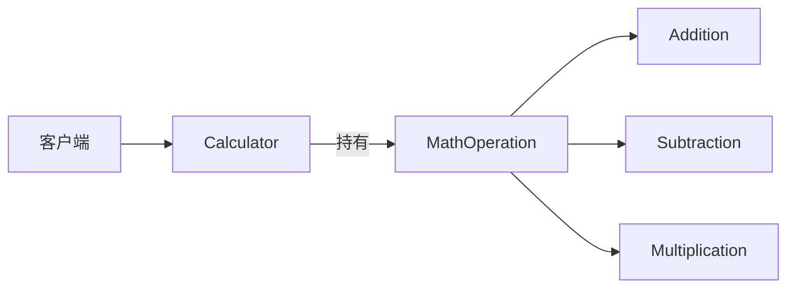
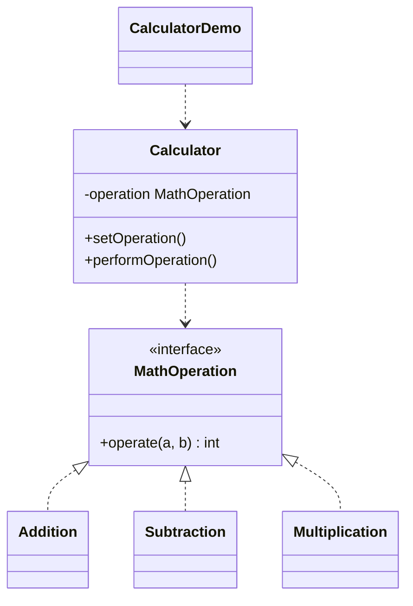

# 计算器 — 策略

> 一个运算操作（加/减/乘）可插拔的计算器，策略可在运行时切换。

## 整体概览

## 场景描述

计算器需要支持用户运行时选择的不同运算。与其硬编码各运算，不如把每种运算
封装为独立的策略对象，计算器可在其间切换。

## 设计模式

**策略** —— 定义一族算法，逐个封装，并使其可互换。

为什么匹配：

- `MathOperation` 是**策略**接口；`Addition`/`Subtraction`/`Multiplication`
  是**具体策略**。
- `Calculator` 是持有策略并委托给它的**上下文**。
- 可通过 `setOperation()` 在运行时更换运算。

## 结构

| 角色 | 参与者 |
|------|--------|
| 策略 | `MathOperation` |
| 具体策略 | `Addition`、`Subtraction`、`Multiplication` |
| 上下文 | `Calculator` |
| 客户端 / 演示 | `CalculatorDemo` |

## 设计理念

- 算法封装在独立类中，可与上下文独立变化。
- 上下文只依赖 `MathOperation` 接口，与具体运算解耦。
- 新增运算只需新建一个策略类，无需改动 `Calculator`。