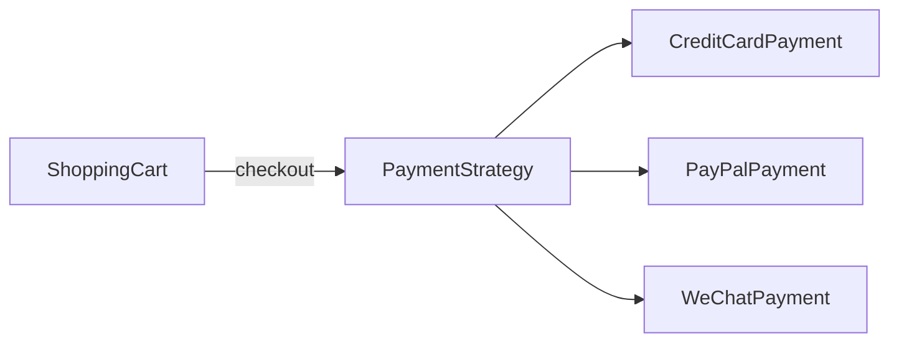
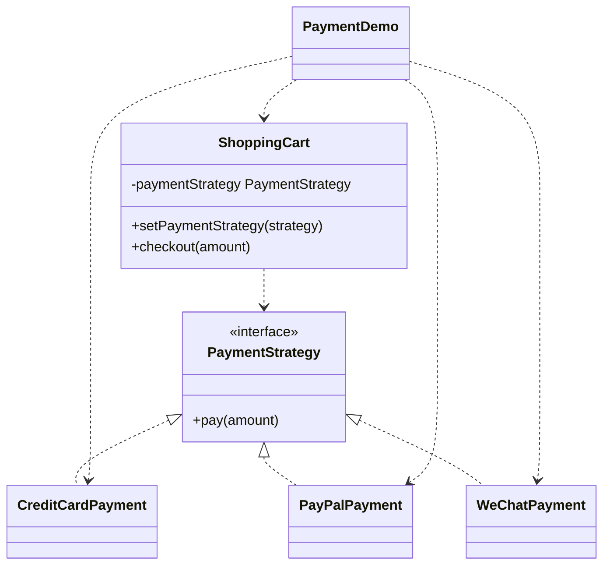

# Payment — Strategy

> A shopping cart switches among credit card, PayPal, and WeChat payment
> methods at checkout without changing its code.

## Big Picture

## Scenario

An online store supports several payment methods. The cart should not be
hard-wired to any one of them. Instead, a payment strategy is plugged in at
runtime and executed on checkout, keeping the cart unchanged when new methods
are added.

## Design Pattern

**Strategy** — defines a family of algorithms, encapsulates each one, and
makes them interchangeable.

Why it fits:

- `PaymentStrategy` is the strategy contract.
- `CreditCardPayment`, `PayPalPayment`, `WeChatPayment` are interchangeable
  strategies.
- `ShoppingCart` (context) holds and delegates to the current strategy.

## Structure

| Role | Participants |
|------|--------------|
| Strategy | `PaymentStrategy` |
| Concrete strategies | `CreditCardPayment`, `PayPalPayment`, `WeChatPayment` |
| Context | `ShoppingCart` |
| Client / demo | `PaymentDemo` |

## Design Rationale

- The payment scenario selects among strategies at runtime, distinct from the
  "Calculator" (math operations) example.
- Three real-world payment methods show how adding a method is isolated to a
  new class, not the context.
- One file per type, following the Java convention, keeps each role readable.