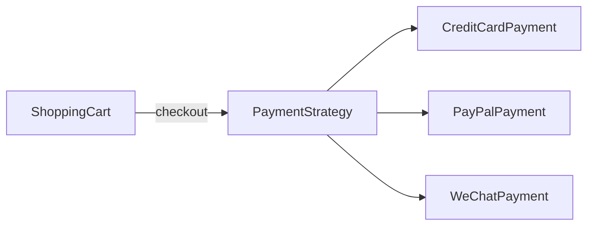
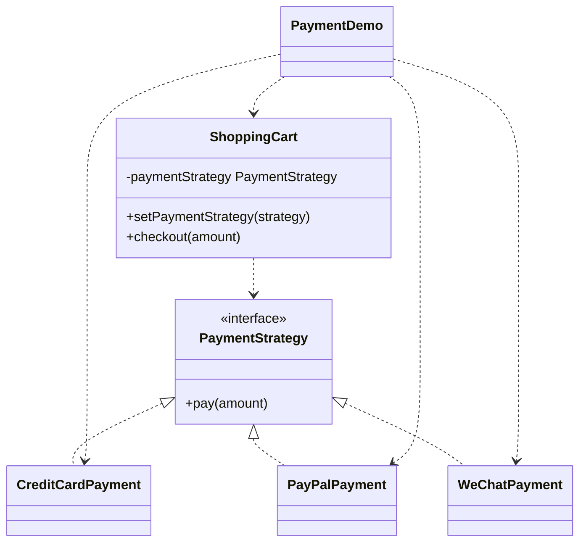

# 支付方式 — 策略

> 购物车在结算时于信用卡、PayPal、微信之间切换支付方式，而无须改动自身代码。

## 整体概览

## 场景描述

在线商店支持多种支付方式。购物车不应与任何一种方式强绑定。相反，支付策略在运行时
被插入，并在结算时执行，从而让购物车在新增支付方式时保持不变。

## 设计模式

**策略** —— 定义一族算法，各自封装，并可相互替换。

为什么匹配：

- `PaymentStrategy` 是策略契约。
- `CreditCardPayment`、`PayPalPayment`、`WeChatPayment` 是可互换的策略。
- `ShoppingCart`（上下文）持有并委托给当前策略。

## 结构

| 角色 | 参与者 |
|------|--------|
| 策略 | `PaymentStrategy` |
| 具体策略 | `CreditCardPayment`、`PayPalPayment`、`WeChatPayment` |
| 上下文 | `ShoppingCart` |
| 客户端 / 演示 | `PaymentDemo` |

## 设计理念

- 支付场景在运行时选择不同策略，与"计算器"（数学运算）示例明显区分。
- 三种真实支付方式展示了新增方式时只需新增一个类，而无需改动上下文。
- 遵循 Java 惯例一个类型一个文件，让每个角色都清晰可读。