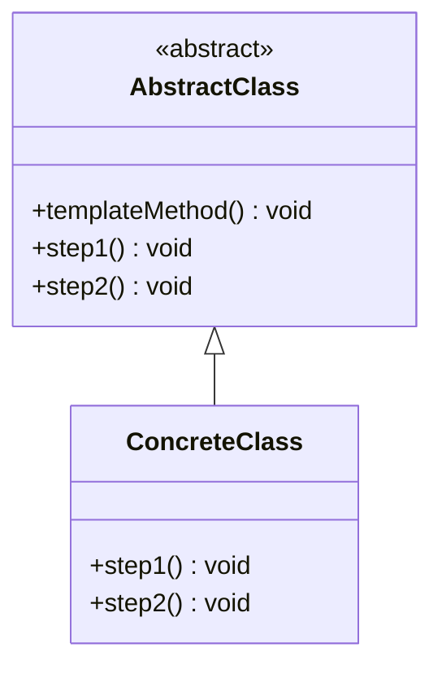

# Template Method Pattern

> Defines the skeleton of an algorithm in an operation, deferring some steps to subclasses.

## Intent

Template Method is a **behavioral** design pattern. It fixes the algorithm skeleton in an abstract parent class and leaves variable steps to subclasses, letting them customize specific steps without changing the overall flow.

## Problem

Some algorithms have a fixed structure, but a few steps vary by context or subclass. You want to fix the core structure while keeping flexibility for specific steps.

## Solution

Template Method defines a template method in the abstract parent class that fixes the flow; variable steps are declared as abstract methods and implemented by subclasses. Subclasses override only the specific steps, keeping the overall flow consistent.

| Role | Description |
|------|-------------|
| Abstract class | Defines the template method and algorithm skeleton, declaring abstract steps |
| Concrete class | Implements the abstract steps to customize behavior |

## Structure

- **AbstractClass**: defines the template method (the skeleton) and declares the steps subclasses must implement.
- **ConcreteClass**: implements the abstract steps to customize behavior.

## Effects

**Pros**

- **Code reuse**: the core algorithm structure is defined once and shared.
- **Flexibility**: subclasses customize specific steps without changing the structure.
- **Maintainability**: the skeleton is managed in one place.
- **Consistency**: all subclasses share the same template.

**Cons**

- **Limited extension**: the fixed skeleton makes the overall structure hard to change.
- **Inheritance constraints**: subclasses must obey the parent's template contract.

**When to use**

- When an algorithm's structure is fixed but some steps may vary.

## Cases in this project

- [Beverage](beverage/README.md) — unifies the coffee and tea preparation flows.
- [Data Processor](dataprocessor/README.md) — unifies the fixed steps of data processing.