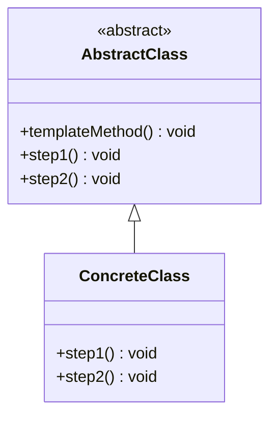

# 模板方法模式（Template Method）

> 定义一个操作中的算法的骨架，而将一些步骤延迟到子类中。

## 意图

模板方法模式（Template Method）是一种**行为型**设计模式。它在抽象父类中固定算法骨架，把可变步骤留给子类实现，从而在不改变整体流程的前提下定制特定步骤。

## 问题

某些算法的结构是固定的，但其中部分步骤会因情境或子类不同而变化。既要固定核心结构，又要为特定步骤保留定制灵活性。

## 解决方案

模板方法模式在抽象父类中定义模板方法，固定算法流程，其中可变步骤用抽象方法表示，由子类实现。子类只需重写特定步骤，整体流程保持一致。

| 角色 | 说明 |
|------|------|
| 抽象类 | 定义模板方法与算法骨架，声明抽象步骤 |
| 具体类 | 实现抽象步骤，定制具体行为 |

## 结构

- **抽象类（AbstractClass）**：定义模板方法（算法骨架），声明需子类实现的步骤。
- **具体类（ConcreteClass）**：实现抽象步骤，定制具体行为。

## 效果

**优点**

- **代码复用**：核心算法结构在父类中定义，供多个子类共享。
- **灵活性**：子类定制特定步骤而不改变整体结构。
- **可维护性**：算法骨架集中管理。
- **一致性**：所有子类共享同一模板，保证流程一致。

**缺点**

- **扩展受限**：算法骨架固定，不易调整整体结构。
- **继承约束**：子类必须遵守父类的模板约定。

**适用场景**

- 算法结构固定、但部分步骤可变的场景。

## 项目中的案例

- [饮品制作](beverage/README_zh.md) —— 用模板方法统一咖啡与茶的制作流程。
- [数据处理](dataprocessor/README_zh.md) —— 用模板方法统一数据处理的固定步骤。