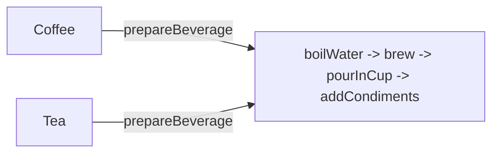
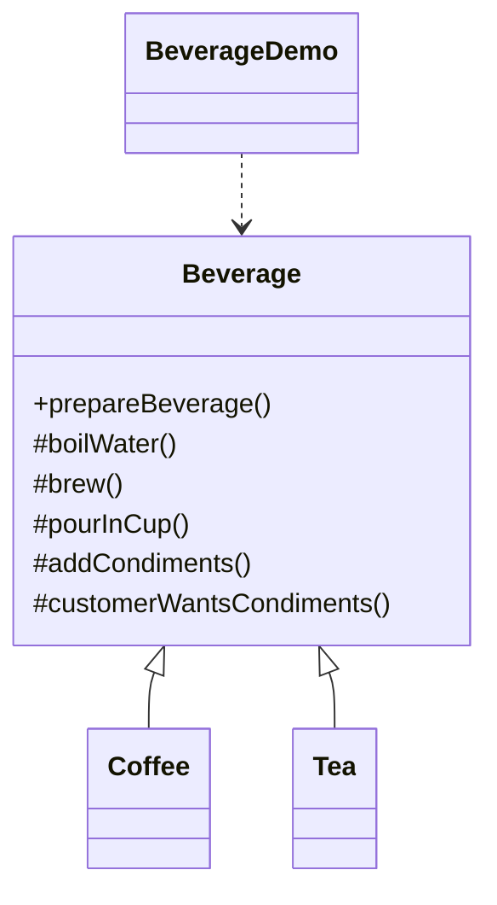

# Beverage — Template Method

> Coffee and tea share a fixed preparation skeleton, differing only in their
> brewing and condiment steps.

## Big Picture

## Scenario

Making coffee and tea follows the same sequence: boil water, brew, pour into a
cup, then add condiments. The overall flow is identical; only brewing and
condiments differ. A template method fixes the skeleton, letting subclasses
fill in the variable steps.

## Design Pattern

**Template Method** — defines the skeleton of an algorithm in a method,
deferring some steps to subclasses.

Why it fits:

- `Beverage.prepareBeverage()` is the `final` template method.
- `boilWater()` and `pourInCup()` are shared concrete steps.
- `brew()` and `addCondiments()` are deferred to `Coffee` and `Tea`.
- `customerWantsCondiments()` is a hook controlling an optional step.

## Structure

| Role | Participants |
|------|--------------|
| Abstract class | `Beverage` |
| Concrete classes | `Coffee`, `Tea` |
| Template method | `prepareBeverage()` |
| Hook | `customerWantsCondiments()` |
| Client / demo | `BeverageDemo` |

## Design Rationale

- The beverage scenario is the canonical template-method example with a hook,
  distinct from the "Data Processor" (CSV/JSON) example.
- Shared steps vs. variable steps plus a hook show the full skeleton
  customization surface.
- One file per type, following the Java convention, keeps each role readable.