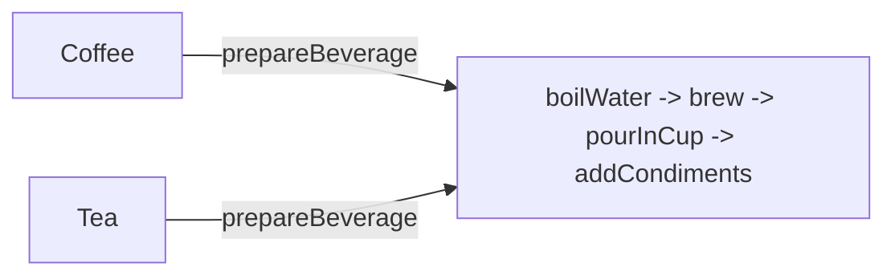
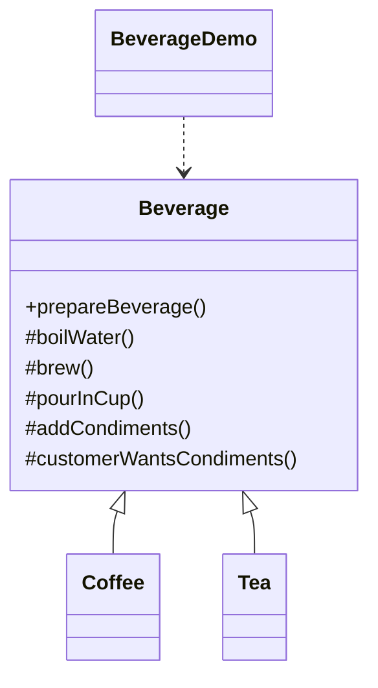

# 饮品制作 — 模板方法

> 咖啡与茶共享固定的制作骨架，仅在冲泡与调料两步上不同。

## 整体概览

## 场景描述

冲泡咖啡与茶的顺序相同：烧水、冲泡、倒入杯中、再加调料。整体流程完全一致，只有
冲泡与调料不同。模板方法固定骨架，让子类填充可变步骤。

## 设计模式

**模板方法** —— 在方法中定义算法骨架，并把某些步骤延迟到子类。

为什么匹配：

- `Beverage.prepareBeverage()` 是 `final` 的模板方法。
- `boilWater()`、`pourInCup()` 是共享的具体步骤。
- `brew()`、`addCondiments()` 延迟到 `Coffee`、`Tea` 实现。
- `customerWantsCondiments()` 是控制可选步骤的钩子。

## 结构

| 角色 | 参与者 |
|------|--------|
| 抽象类 | `Beverage` |
| 具体类 | `Coffee`、`Tea` |
| 模板方法 | `prepareBeverage()` |
| 钩子 | `customerWantsCondiments()` |
| 客户端 / 演示 | `BeverageDemo` |

## 设计理念

- 饮品场景是模板方法的经典示例，且带有钩子，与"数据处理"（CSV/JSON）示例明显区分。
- 共享步骤 vs 可变步骤，加上钩子，完整展示了骨架的可定制面。
- 遵循 Java 惯例一个类型一个文件，让每个角色都清晰可读。