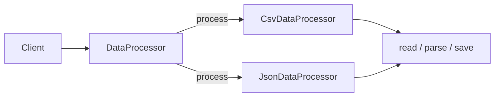
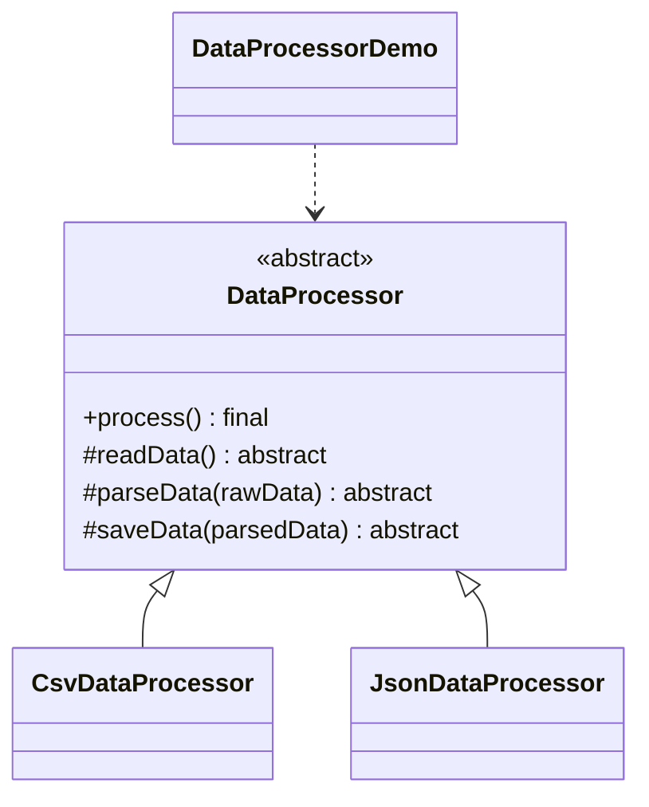

# Data Processor — Template Method

> Defines a fixed algorithm skeleton in an abstract class and lets subclasses
> fill in the concrete steps.

## Big Picture

## Scenario

A data-import pipeline always runs the same three steps — read the raw data,
parse it, and save the result — but the file format (CSV vs JSON) changes the
concrete work in each step. The template method fixes the order, while
subclasses implement the individual steps.

## Design Pattern

**Template Method** — defines the skeleton of an algorithm in an operation,
deferring some steps to subclasses.

Why it fits:

- `DataProcessor` holds the `process()` method that calls `readData()` /
  `parseData()` / `saveData()` in a fixed order.
- `CsvDataProcessor` and `JsonDataProcessor` implement only the abstract steps.
- The skeleton cannot be overridden (`final`), so the algorithm order is stable.

## Structure

| Role | Participants |
|------|--------------|
| Abstract class | `DataProcessor` |
| Concrete classes | `CsvDataProcessor`, `JsonDataProcessor` |
| Client / demo | `DataProcessorDemo` |

## Design Rationale

- The algorithm skeleton is centralized in one place, avoiding duplication across
  subclasses.
- Marking `process()` as `final` prevents subclasses from breaking the defined
  order.
- Subclasses only implement the variable steps, keeping them focused and small.