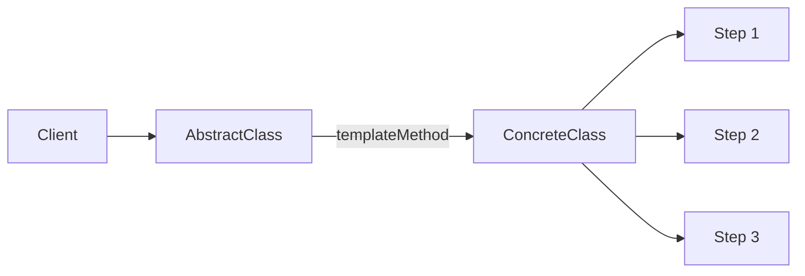
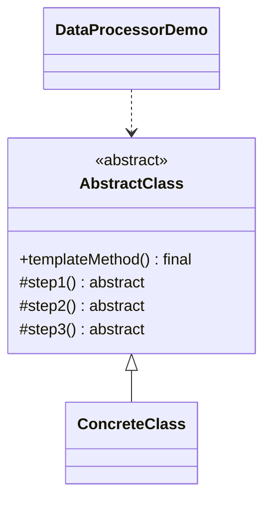

# Data Processor — Template Method

> Defines a fixed algorithm skeleton in an abstract class and lets a subclass
> fill in the concrete steps.

## Big Picture

## Scenario

A data-processing pipeline always runs the same three steps, but the concrete
work in each step may vary. The template method fixes the order, while subclasses
implement the individual steps.

## Design Pattern

**Template Method** — defines the skeleton of an algorithm in an operation,
deferring some steps to subclasses.

Why it fits:

- `AbstractClass` holds the `templateMethod()` that calls `step1()`/`step2()`/
  `step3()` in a fixed order.
- `ConcreteClass` implements the abstract steps.
- The skeleton cannot be overridden (`final`), so the algorithm order is stable.

## Structure

| Role | Participants |
|------|--------------|
| Abstract class | `AbstractClass` |
| Concrete class | `ConcreteClass` |
| Client / demo | `DataProcessorDemo` |

## Design Rationale

- The algorithm skeleton is centralized in one place, avoiding duplication across
  subclasses.
- Marking `templateMethod()` as `final` prevents subclasses from breaking the
  defined order.
- Subclasses only implement the variable steps, keeping them focused and small.