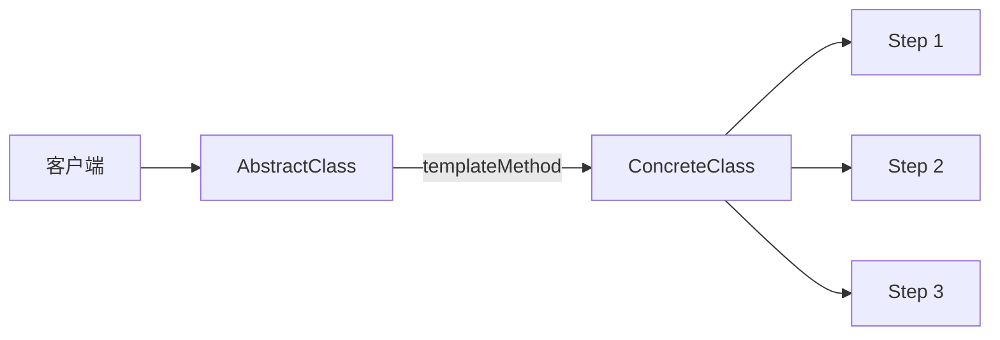
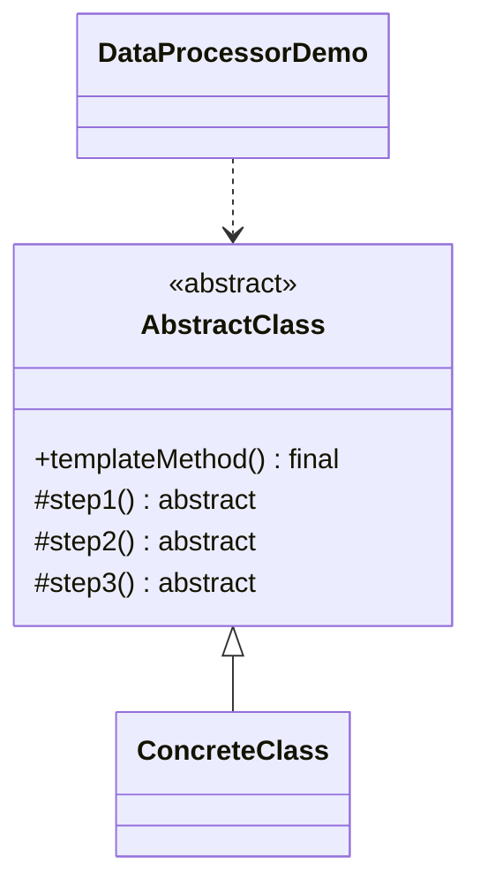

# 数据处理 — 模板方法

> 在抽象类中定义固定的算法骨架，由子类填充具体步骤。

## 整体概览

## 场景描述

一个数据处理流程总是按同样的三步运行，但每步的具体工作可能不同。模板方法
固定了顺序，由子类实现各个步骤。

## 设计模式

**模板方法** —— 在一个操作中定义算法骨架，将某些步骤延迟到子类实现。

为什么匹配：

- `AbstractClass` 持有 `templateMethod()`，按固定顺序调用 `step1()`/`step2()`/
  `step3()`。
- `ConcreteClass` 实现这些抽象步骤。
- 骨架方法用 `final` 修饰，防止被重写，从而保证算法顺序稳定。

## 结构

| 角色 | 参与者 |
|------|--------|
| 抽象类 | `AbstractClass` |
| 具体类 | `ConcreteClass` |
| 客户端 / 演示 | `DataProcessorDemo` |

## 设计理念

- 算法骨架集中在一处，避免在各子类中重复。
- 将 `templateMethod()` 标记为 `final`，防止子类破坏既定顺序。
- 子类只实现可变步骤，保持聚焦且精简。