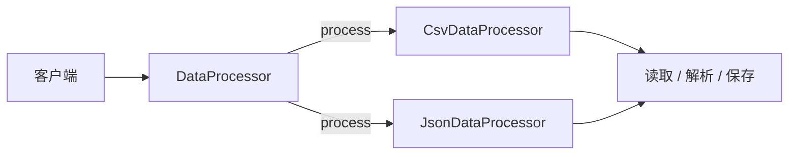
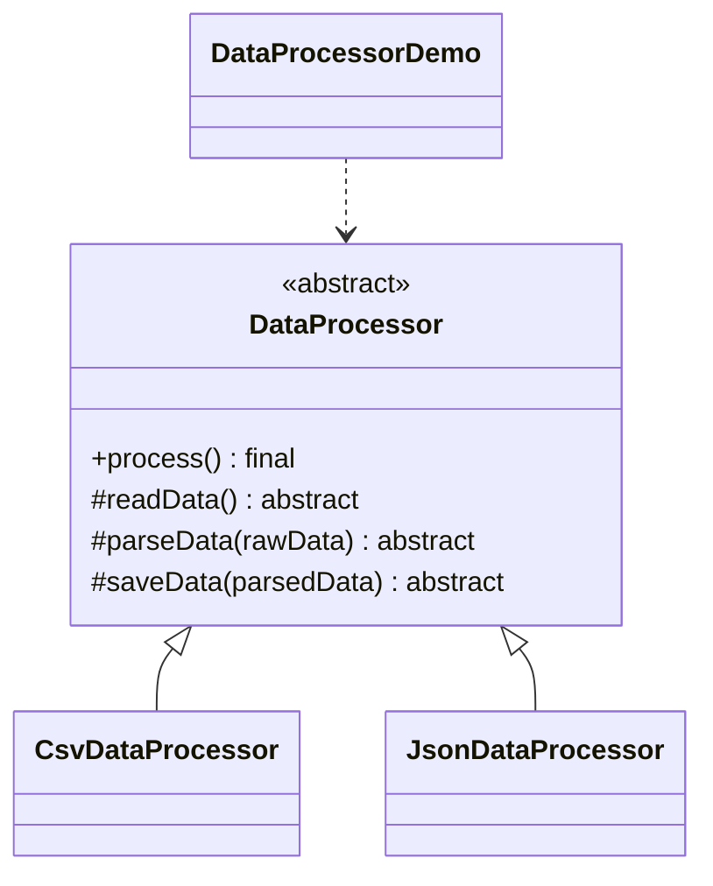

# 数据处理 — 模板方法

> 在抽象类中定义固定的算法骨架，由子类填充具体步骤。

## 整体概览

## 场景描述

一个数据导入流程总是按同样的三步运行：读取原始数据、解析数据、保存结果，但文件
格式（CSV 还是 JSON）会让每步的具体工作不同。模板方法固定了顺序，由子类实现各
个步骤。

## 设计模式

**模板方法** —— 在一个操作中定义算法骨架，将某些步骤延迟到子类实现。

为什么匹配：

- `DataProcessor` 持有 `process()`，按固定顺序调用 `readData()`/`parseData()`/
  `saveData()`。
- `CsvDataProcessor` 与 `JsonDataProcessor` 只实现这些抽象步骤。
- 骨架方法用 `final` 修饰，防止被重写，从而保证算法顺序稳定。

## 结构

| 角色 | 参与者 |
|------|--------|
| 抽象类 | `DataProcessor` |
| 具体类 | `CsvDataProcessor`、`JsonDataProcessor` |
| 客户端 / 演示 | `DataProcessorDemo` |

## 设计理念

- 算法骨架集中在一处，避免在各子类中重复。
- 将 `process()` 标记为 `final`，防止子类破坏既定顺序。
- 子类只实现可变步骤，保持聚焦且精简。