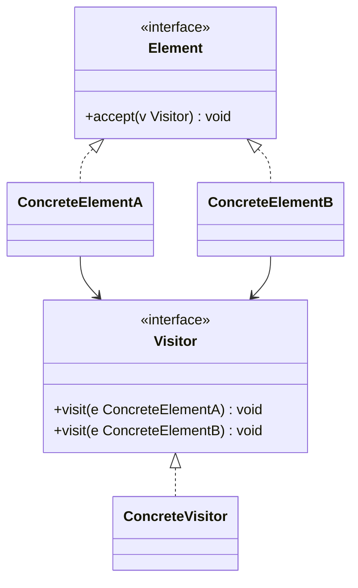

# Visitor Pattern

> Represents an operation to be performed on the elements of an object structure, letting you define a new operation without changing the classes of the elements on which it operates.

## Intent

Visitor is a **behavioral** design pattern. It separates operations from element classes by encapsulating them in visitors, so new operations can be added without modifying the elements.

## Problem

When the elements of an object structure need many different operations, the operations become coupled to the element classes; adding a new operation forces you to modify those classes, making extension hard and affecting existing code.

## Solution

Visitor introduces a visitor interface that declares an access method for each element type; elements accept the visitor and pass themselves to it, letting the visitor perform the operation on them, decoupling operations from elements.

| Role | Description |
|------|-------------|
| Visitor | Declares an access operation for each element type |
| Concrete visitor | Implements the concrete operations on elements |
| Element | Declares the accept method |
| Concrete element | Implements accept, passing itself to the visitor |
| Object structure | Maintains the element collection for the visitor to traverse |

## Structure

- **Visitor**: declares an access method for each element type.
- **ConcreteVisitor**: implements the concrete operations on elements.
- **Element**: declares the accept method.
- **ConcreteElement**: implements `accept`, passing itself to the visitor.

## Effects

**Pros**

- **Separation of concerns**: elements focus on their own duties; operations live in visitors.
- **Easy extension**: new operations are added via new visitors without touching elements.
- **Maintainability**: each operation is encapsulated in its own visitor.

**Cons**

- **Not for frequently changing elements**: element changes force frequent visitor interface changes.

**When to use**

- When you need multiple operations over a set of heterogeneous objects without modifying the element classes.

## Cases in this project

- [Shopping Cart](shoppingcart/README.md) — applies different operations to items in a cart.
- [Area Calculator](areacalculator/README.md) — computes areas for different shapes.