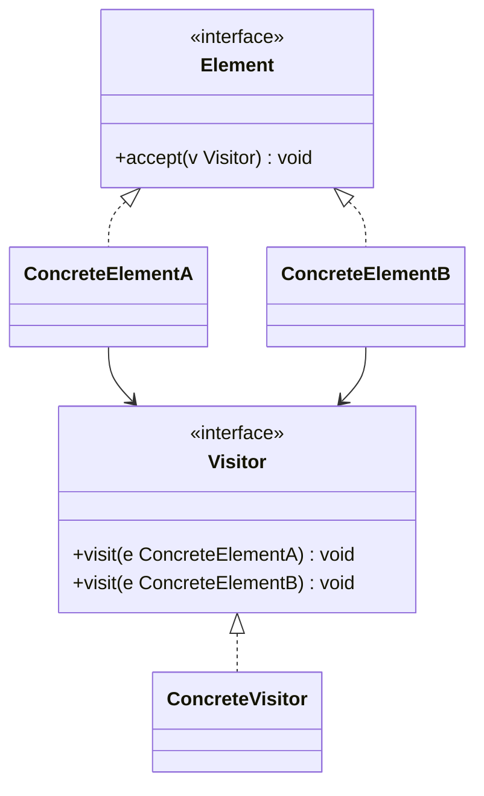

# 访问者模式（Visitor）

> 表示一个作用于某对象结构中的各元素的操作。它使你可以在不改变各元素的类的前提下定义作用于这些元素的新操作。

## 意图

访问者模式（Visitor）是一种**行为型**设计模式。它把操作从元素类中分离出来，封装到访问者里，从而在不修改元素类的前提下添加新操作。

## 问题

当一个对象结构中的元素类需要进行多种不同操作时，操作常与元素类耦合，添加新操作就必须修改元素类，难以扩展且影响现有代码。

## 解决方案

访问者模式引入访问者接口，其中为每种元素声明访问方法；元素接受访问者并将自身传递给访问者，由访问者对元素执行相应操作，实现操作与元素解耦。

| 角色 | 说明 |
|------|------|
| 访问者 | 为每种元素声明访问操作 |
| 具体访问者 | 实现对元素的具体操作 |
| 元素 | 声明接受访问者的方法 |
| 具体元素 | 实现接受方法，把自身传递给访问者 |
| 对象结构 | 维护元素集合，供访问者遍历 |

## 结构

- **访问者（Visitor）**：为每种元素声明访问方法。
- **具体访问者（ConcreteVisitor）**：实现对各元素的具体操作。
- **元素（Element）**：声明接受访问者的方法。
- **具体元素（ConcreteElement）**：实现 `accept`，把自身传给访问者。

## 效果

**优点**

- **分离关注点**：元素类专注自身职责，操作由访问者实现。
- **易于扩展**：新增操作只需新增访问者，不修改元素类。
- **可维护性**：每个操作封装在独立访问者中。

**缺点**

- **不适于元素频繁变化**：元素类变化会导致访问者接口频繁修改。

**适用场景**

- 需要对一组不同类型的对象执行多种不同操作，且希望在不修改元素类的前提下扩展操作的场景。

## 项目中的案例

- [购物车](shoppingcart/README_zh.md) —— 用访问者对购物车中的商品执行不同操作。
- [面积计算](areacalculator/README_zh.md) —— 用访问者对不同图形计算面积。