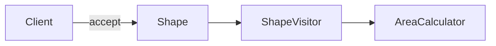
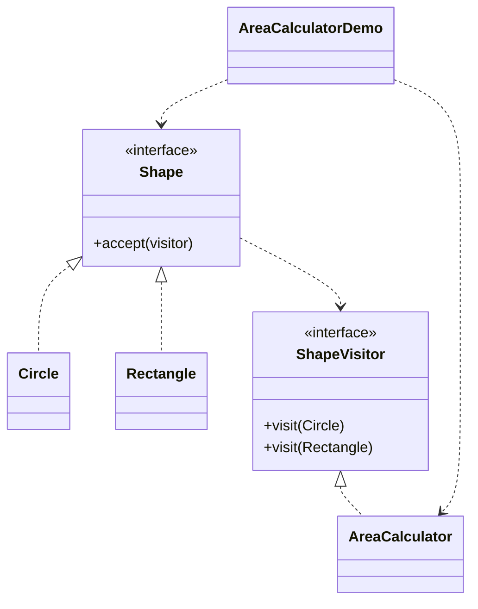

# Area Calculator — Visitor

> Computes the total area of different shapes by moving the area logic into a
> visitor, so shapes stay unchanged when new operations are added.

## Big Picture

## Scenario

A graphics system has circles and rectangles. Instead of putting the area logic
into each shape, a visitor object accepts each shape and computes its area, making
it easy to add new operations later.

## Design Pattern

**Visitor** — represents an operation to be performed on the elements of an
object structure, letting you define a new operation without changing the element
classes.

Why it fits:

- `Shape` is the **element**; `Circle` and `Rectangle` are **concrete elements**
  that call `visitor.visit(this)` in `accept()`.
- `ShapeVisitor` is the **visitor** interface; `AreaCalculator` is a **concrete
  visitor** that accumulates area.

## Structure

| Role | Participants |
|------|--------------|
| Element | `Shape` |
| Concrete elements | `Circle`, `Rectangle` |
| Visitor | `ShapeVisitor` |
| Concrete visitor | `AreaCalculator` |
| Client / demo | `AreaCalculatorDemo` |

## Design Rationale

- The operation (area) is externalized from the shapes, so adding a new operation
  means adding a visitor, not changing shapes.
- Double dispatch (`accept` → `visit`) routes the call to the correct overload.
- Shapes remain stable even as the set of operations grows.