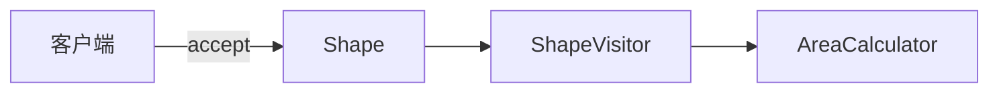
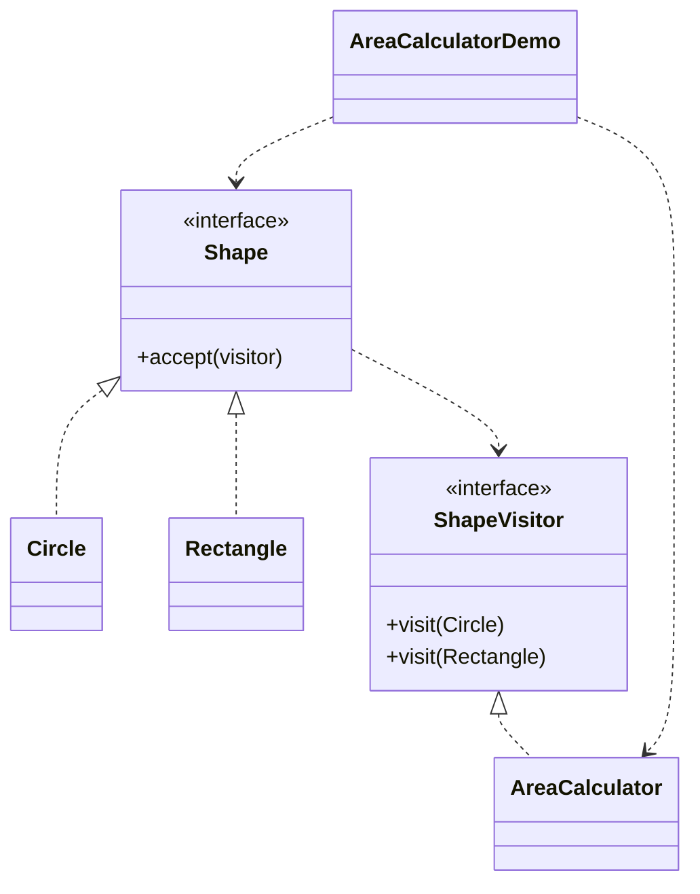

# 面积计算 — 访问者

> 把面积逻辑移入访问者，计算不同图形的总面积，使图形在新增操作时保持不变。

## 整体概览

## 场景描述

图形系统中有圆形和矩形。与其把面积逻辑塞进每个图形，不如用一个访问者对象
接受每个图形并计算面积，日后新增操作也更容易。

## 设计模式

**访问者** —— 表示在对象结构元素上执行的操作，让你在不改动元素类的前提下
定义新操作。

为什么匹配：

- `Shape` 是**元素**；`Circle` 和 `Rectangle` 是**具体元素**，在 `accept()`
  中调用 `visitor.visit(this)`。
- `ShapeVisitor` 是**访问者**接口；`AreaCalculator` 是累加面积的**具体访问者**。

## 结构

| 角色 | 参与者 |
|------|--------|
| 元素 | `Shape` |
| 具体元素 | `Circle`、`Rectangle` |
| 访问者 | `ShapeVisitor` |
| 具体访问者 | `AreaCalculator` |
| 客户端 / 演示 | `AreaCalculatorDemo` |

## 设计理念

- 操作（面积）从图形中抽离，新增操作只需新增访问者，无需改动图形。
- 双重分派（`accept` → `visit`）把调用路由到正确的重载方法。
- 即使操作集合不断增长，图形类依然保持稳定。