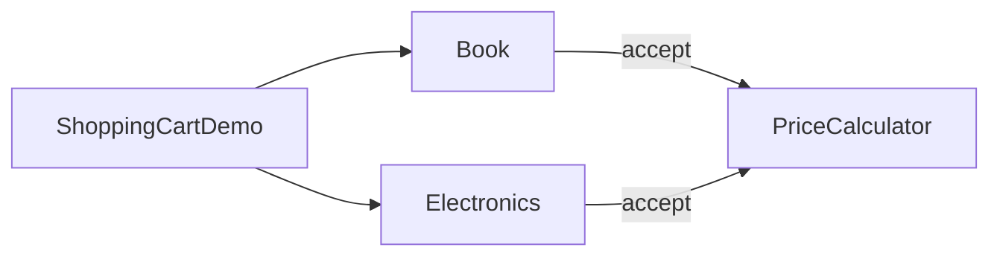
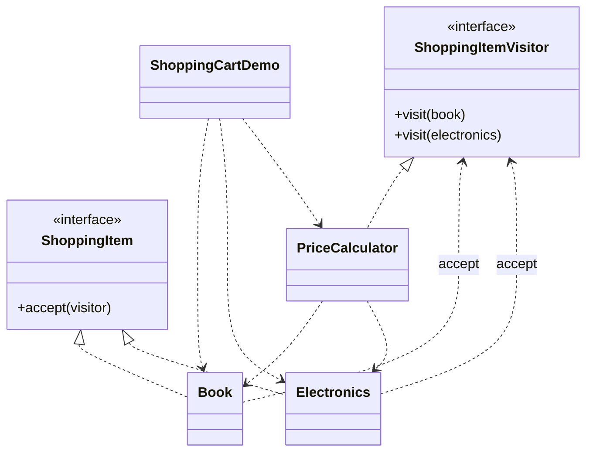

# Shopping Cart — Visitor

> A price calculator visits book and electronics items to total the cart,
> without those items knowing how pricing works.

## Big Picture

## Scenario

A shopping cart holds heterogeneous items such as books and electronics. To
total the price, a visitor applies item-specific logic. Adding a new operation
means adding a new visitor, not modifying the item classes.

## Design Pattern

**Visitor** — represents an operation to be performed on the elements of an
object structure, letting you add operations without changing the elements.

Why it fits:

- `ShoppingItemVisitor` declares a visit method per element type.
- `Book` and `Electronics` accept a visitor via double dispatch.
- `PriceCalculator` implements the pricing operation.

## Structure

| Role | Participants |
|------|--------------|
| Visitor | `ShoppingItemVisitor` |
| Concrete visitor | `PriceCalculator` |
| Element | `ShoppingItem` |
| Concrete elements | `Book`, `Electronics` |
| Client / demo | `ShoppingCartDemo` |

## Design Rationale

- The shopping-cart scenario applies the visitor to a commerce domain,
  distinct from the "Area Calculator" (geometry) example.
- Heterogeneous items (book vs. electronics) show how operations vary by
  element type without touching the element classes.
- One file per type, following the Java convention, keeps each role readable.