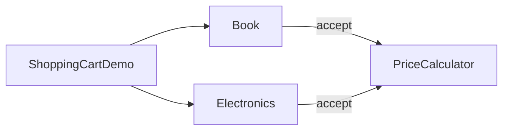
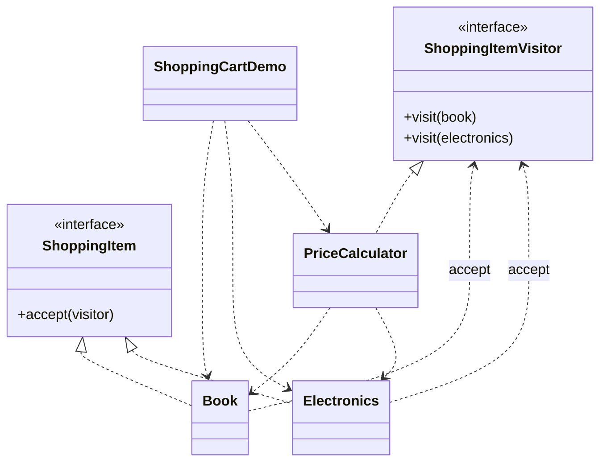

# 购物车 — 访问者

> 价格计算器访问书籍与电子产品元素以汇总购物车，而这些元素无需了解计价逻辑。

## 整体概览

## 场景描述

购物车容纳书籍、电子产品等异构条目。为汇总价格，访问者对每种条目应用特定逻辑。
新增操作只需新增一个访问者，而无需改动条目类。

## 设计模式

**访问者** —— 表示作用于对象结构中元素的操作，从而在不改动元素的前提下新增操作。

为什么匹配：

- `ShoppingItemVisitor` 为每种元素类型声明 visit 方法。
- `Book`、`Electronics` 通过双重分派接受访问者。
- `PriceCalculator` 实现计价操作。

## 结构

| 角色 | 参与者 |
|------|--------|
| 访问者 | `ShoppingItemVisitor` |
| 具体访问者 | `PriceCalculator` |
| 元素 | `ShoppingItem` |
| 具体元素 | `Book`、`Electronics` |
| 客户端 / 演示 | `ShoppingCartDemo` |

## 设计理念

- 购物车场景把访问者应用到商业领域，与"面积计算"（几何）示例明显区分。
- 异构条目（书籍 vs 电子产品）展示了操作随元素类型变化，而无需改动元素类。
- 遵循 Java 惯例一个类型一个文件，让每个角色都清晰可读。